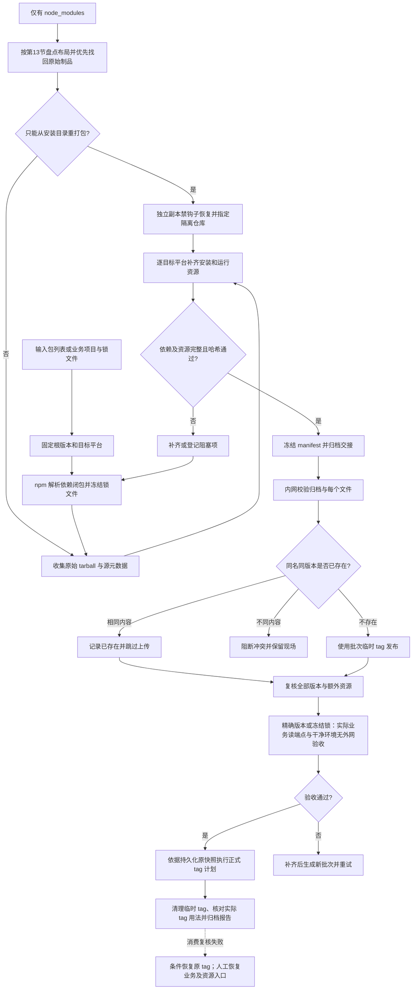
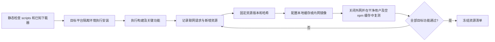
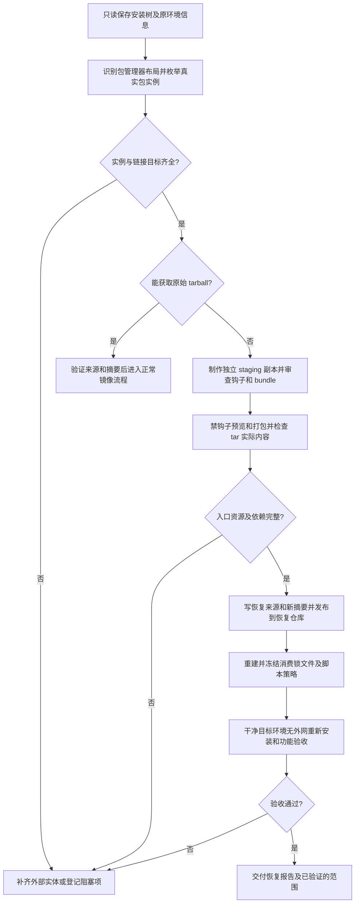

# npm 批量下载与内网离线发布：技术方案及操作手册

版本：1.4 · 日期：2026-10-09 · 模式：Ponytail full

## 1. 目标与当前状态

将指定 npm 包及其完整安装依赖、必要的非 npm 资源从互联网收集为可校验的交付包，在无互联网的内网批量发布到 npm 私服，并正确处理多个版本、dist-tag、重复导入与失败恢复。

**当前已有首版 CLI**：收集、安装树盘点/恢复、交付校验、导入预检查、精确版本导入、正式 tag 提升与条件恢复。可执行参数、实际清单结构、资源/验收 JSON 示例见 [实现架构与运行指南](docs/architecture.md)。本文继续保留完整运维要求和手工 npm 参考；这些要求不等于 CLI 已自动覆盖所有检查。目标私服、完整业务与平台资源仍须部署方验收。

采用最小架构：**npm 原生解析依赖 + 原始 tarball + JSON 清单 + 现有内网 npm 私服 + 分阶段发布**。先用单机命令行实现；不引入数据库、队列、Web 管理端，也不自行实现 SemVer 或 peer 依赖解析器。

默认交付某批指定版本的依赖闭包，不镜像整个 npm，也不自动下载每个包的所有历史版本。需要多个根版本时分别解析，再合并制品。

只有已安装的 `node_modules` 时，使用第 13 节的**恢复模式**：优先找回原始制品，目录重打包作为受限兜底，明确区分原始镜像与恢复制品。

### 1.1 首版快速入口

无需安装本项目的 npm 依赖。从项目目录使用 Node 22+、**npm 11.19.0** 与系统 `tar`：

```sh
node src/cli.mjs --help
npm test

# resources.json 必须按运行指南记录本地资源及审查证据；无额外资源也应显式审查。
node src/cli.mjs collect \
  --project /absolute/path/to/business \
  --out /absolute/path/to/bundle \
  --registry https://registry.npmjs.org/ \
  --resources /absolute/path/to/resources.json

node src/cli.mjs verify --bundle /absolute/path/to/bundle

# 交接到内网后，写端点与业务实际读端点分别绑定。
node src/cli.mjs plan \
  --bundle /absolute/path/to/bundle \
  --registry https://npm.intranet.example/hosted/ \
  --read-registry https://npm.intranet.example/group/

node src/cli.mjs import \
  --bundle /absolute/path/to/bundle \
  --registry https://npm.intranet.example/hosted/ \
  --read-registry https://npm.intranet.example/group/ \
  --run /absolute/path/to/runs/batch-a

# 真实无外网、空缓存、业务读路由验收后填写 acceptance.json，才提升正式 tag。
node src/cli.mjs promote \
  --run /absolute/path/to/runs/batch-a \
  --acceptance /absolute/path/to/acceptance.json

node src/cli.mjs rollback --run /absolute/path/to/runs/batch-a
```

`import` 成功返回 `versions-ready`，表示精确版本就绪，尚未正式提升 tags；`promote` 接受实际验收记录。run 放在冻结 bundle 外；重复 import 使用同一个 run，读写端点、模式与 bundle 不变。已有不同正式 tag 默认阻断，审查后确需替换才给 promote 加 `--overwrite-tags`。

| 命令 | 当前用途 |
| --- | --- |
| `collect --project` / `--packages-file` / 重复 `--package` | 有 npm v2/v3 锁的项目，或批量独立 registry 根规格 |
| `inventory --node-modules` | 只读盘点 npm/Yarn/pnpm 实体安装树 |
| `recover --node-modules --registry` | 根据现存包身份回源取原始 tarball |
| `recover --node-modules --repack` | 独立 staging 禁钩子重打包；导入专用恢复仓库时加 `--recovery` |
| `verify` / `plan` | 文件/制品校验，或只读查目标版本与 tag 差异 |
| `import` / `promote` / `rollback` | 临时 tag 导入、验收后正式 tag、条件恢复 |

首版不自动解析 Yarn/pnpm 原生锁、PnP、Git/workspace 或重放补丁；目录恢复遇到 bundledDependencies 直接阻断；非 npm 资源只复制显式本地文件/目录。其他范围及操作示例以 [运行指南](docs/architecture.md#2-工具链与支持范围) 为准。

### 1.2 批量输入、进度与统计

大量根包写入 JSON 字符串数组，避免逐个手写命令：

```json
[
  "example-package@1.2.3",
  "@example/widget@2.0.0",
  "another-package@^3.0.0"
]
```

```sh
node src/cli.mjs collect \
  --packages-file /absolute/path/to/packages.json \
  --package extra-package@4.0.0 \
  --out /absolute/path/to/batch-bundle \
  --registry https://registry.npmjs.org/ \
  --resources /absolute/path/to/resources.json \
  --progress=plain > collect-result.json
```

`--packages-file` 可与重复 `--package` 合并，不能与 `--project` 混用。每个根分别解析，传递依赖合并为唯一制品；首版串行批量处理，并保留各根的冻结锁。已有安装树用一次 inventory/recover 扫描真实包根，支持嵌套 node_modules 内的 `.pnpm` 与 `.store`，不需要逐包 pack/publish。

进度写 stderr，最终 JSON 写 stdout；默认 `--progress=auto` 在终端显示进度条，重定向时显示普通进度文字。`--progress=plain` 固定文字，`--progress=none` 关闭进度。终端在耗时操作期间定期刷新，普通文字按包/阶段更新；npm 原生命令不提供本工具可用的逐字节网络上传进度。

结果的 `stats` 区分本次执行的上传、复用、制品取得/校验和重打包数量，以及实际 tarball 字节。收集的 downloaded 是源制品；plan/import/promote 的 downloaded 是目标校验取得的制品。同一版本反复校验可重复计数，制品获取使用独立缓存避免旧文件掩盖远端变化；数值不代表网络实传总量、累计仓库容量、元数据、资源复制或 HTTP 编码开销。详见 [统计说明](docs/architecture.md#42-进度与统计)。

## 2. 环境与边界

| 位置 | 作用 | 必备条件 |
| --- | --- | --- |
| 外网收集机 | 解析依赖、获取 tarball、收集额外资源 | 已批准的 Node.js/npm、源 registry 访问权限、目标平台验证环境 |
| 离线交付介质 | 转移归档及校验信息 | 足够空间；归档摘要通过独立可信渠道交接 |
| 内网导入机 | 校验、上传制品、恢复 tag | 相同工具版本、内网私服发布及 tag 权限 |
| 内网使用机 | 安装、编译、运行验收 | 目标 OS/CPU/libc、相应 Node ABI、必要系统库与工具链 |
| 内网 npm 私服 | 提供包元数据与 tarball | 已有支持 npm publish、view、dist-tag 的托管仓库 |
| 内网资源存储 | 提供浏览器/二进制等额外资源 | 现有文件共享或 HTTP 服务；也可直接分发本地缓存 |

目标 registry 必须是**可写的托管仓库端点**；客户端可使用私服的聚合读端点。不能默认向只读代理或聚合端点发布。目标仓库的产品、版本、地址与权限由部署方填写；npm 命令兼容性先用测试命名空间验证。

分别登记 `TARGET_REGISTRY`（托管写端点）与 `CLIENT_REGISTRY`（业务实际读端点）。聚合仓库的成员顺序、同名内部包优先级、外网代理回源开关，以及反向代理返回的 tarball 地址均要验证；不能用托管写端点安装成功代替真实客户端路由验收。

内网允许访问私服和内部资源服务。“离线”指没有互联网，**不等于每次安装都使用 `npm --offline`**：空缓存验收需要通过内网 HTTP 获取包。

固定并记录 Node.js、npm、OS、CPU、libc、安装参数。跨平台要逐平台验证；不能用 macOS 的安装结果证明 Linux 或 Windows 的制品齐全。

CLI 运行使用 Node 22+；打包路径固定 npm 11.19.0。本文本地钩子验证所用工具链为 Node 24.21.0/npm 11.19.0，可以运行在独立打包机，消费端仍使用业务原工具链。不要把旧版 npm 的 `--ignore-scripts` 当作所有钩子的统一保证：目录 prepare 的版本差异见第 13.4 节。

## 3. 总体流程图

可直接查看 [SVG 总流程图](docs/offline-npm-flow.svg)。下图 Mermaid 源可随文档维护。



## 4. 如何覆盖依赖的依赖

### 4.1 三种输入

**业务项目迁移（优先）**：输入项目 `package.json`、`package-lock.json` 或 `npm-shrinkwrap.json` 及不含凭证的安装配置；workspaces 源码属于额外迁移输入，首版 CLI 会阻断 workspace。使用原项目锁文件，保留它已选定的每个版本。存在 shrinkwrap 时以 npm 实际使用的文件为准。`npm ci` 要求包声明与锁文件一致；它不会替用户修正锁文件。CLI 项目模式必须提供 npm v2/v3 锁，不为缺失项目锁自动选择新版本。[npm ci 官方说明](https://docs.npmjs.com/cli/v11/commands/npm-ci/)

**独立包清单**：输入 `name@精确版本`，例如 `@scope/pkg@1.2.3`。若输入 tag 或版本范围，先在外网解析成具体版本并冻结结果。每个根版本在独立临时项目中生成锁文件，再按实际 `name + version` 合并；不同业务项目也分别保留锁文件。这样避免为多个不兼容根版本强行生成一棵树。

**仅有 node_modules**：输入安装树快照及能取得的包管理器元数据、链接目标、缓存和原运行环境信息。按第 13 节恢复现存包实例；不能把盘点结果直接宣称为完整业务锁文件或跨平台依赖闭包。

**覆盖承诺绑定到输入锁文件、目标平台及已验证的使用方式。** 独立根包分别解析后取并集，不代表它们一起安装时仍选相同的 peer/传递版本，也不保证未来新增根包、无锁文件安装或全局 CLI 安装成功。实际要组合使用的根包须再用业务项目共同解析与验收；全局安装作为单独场景验证，不能用一次 `npm install -g` 推导可重复的闭包。首版支持的交付物是“指定场景的版本快照”，扩展使用范围需另收集一批。

解析应复用 npm，不通过递归 `npm view dependencies` 自己选版本。依赖冲突必须处理或按业务已有安装参数重现；不默认加 `--force` 或 `--legacy-peer-deps` 绕过。

### 4.2 收集范围

| 类型 | 方案 |
| --- | --- |
| dependencies | 收集锁文件选中的直接及传递版本 |
| 根项目 devDependencies | 默认收集，以支持内网构建；只运行场景须单独定义并验收 |
| 第三方包 devDependencies | 不因下载该包而递归收集它的开发工具链；自行重构第三方源码时另计 |
| peerDependencies | 收集 npm 实际解析的 peer；可选 peer 是否需要由业务功能确定 |
| optionalDependencies | 收集各目标平台锁文件需要的版本；安装被跳过不等于资源不需要 |
| bundledDependencies | 先确认随父 tarball 已携带；仅内嵌条目不单独发布，也不漏掉父包其他外部依赖 |
| npm alias | 记录别名位置，按 tarball 内实际包名和版本发布，不能以别名重命名 |
| workspace / file / link | 随业务源码交付或作为内部包独立构建发布；不能当作公开 registry 包下载 |
| git / 任意 HTTP tarball | 显式列为非 registry 输入；保留源码/制品及精确提交，或审查后改为内部包并重新冻结锁文件 |

保留业务根 `package.json` 的 `overrides`、脚本许可策略以及影响依赖树的 `.npmrc` 配置；不要只拿依赖列表重建业务项目。CLI 不复制项目 `.npmrc`，仅提供受控 `--install-flag=--legacy-peer-deps`、`--install-flag=--strict-peer-deps`、`--install-flag=--install-links=true/false`；其他配置先在外网验证并单独记录。npm 的 overrides 仅在项目根生效，发布包还可能通过内嵌 shrinkwrap 固定依赖；应让 npm 读取原声明解析，不能自行展开后丢失这些约束。[package.json 官方规则](https://docs.npmjs.com/cli/v11/configuring-npm/package-json/)

Git 源包是第三方 devDependencies 规则的例外：安装可能先克隆、安装构建依赖并执行 prepare/build。仅镜像 Git 提交和运行时依赖不足以保证离线构建；首版遇到这类输入先阻断并走受控方案。在外网完成构建、交付固定内部制品时，保留提交/构建记录，明确修改业务引用并重冻结锁文件；若保留内网 Git 安装，则另交付 Git 镜像、构建依赖闭包及工具链。[Git 依赖官方行为](https://docs.npmjs.com/cli/v11/configuring-npm/package-json/#git-urls-as-dependencies)

从锁文件所有 `packages` 条目提取，而非只遍历第一层 `dependencies`。首版 CLI 接收 v2/v3；v1 用固定 npm 在外网转换、复核并保留原件，不静默猜测。

锁文件包含 `version`、`resolved`、`integrity`，也包含链接和内嵌依赖信息，字段含义见 [package-lock 官方说明](https://docs.npmjs.com/cli/v11/configuring-npm/package-lock-json/)。缺失下载信息的非链接、非内嵌条目需要补查源元数据；无法确定来源则阻断。

### 4.3 多版本、多平台与闭包检查

同一包的 `1.0.0` 与 `2.0.0` 是两个制品，不合并成一个最高版本。多个路径指向同一实际包版本时复用 tarball；若源仓库不同却给出相同 `name@version` 的不同内容，作为冲突处理。

在每个目标环境的干净目录解析/验证依赖，合并全部目标的制品清单。对已有业务锁文件，不擅自替换版本；若跨平台可选包缺失，在外网受控副本中补齐并审查差异。最终交付按目标记录锁文件摘要，避免验证时又解析到新版本。

完成标准：每个已选中的 registry 依赖都有可校验 tarball；每个跳过条目都有原因；必要 peer、平台包和非 registry 输入均有处理记录。遇到 ERESOLVE、无法访问的私包或缺失版本，不得将批次标记为“完整”。

禁用 optional、设置 `NODE_ENV=production` 或启用 omit 的测试不能证明构建场景完整；记录解析与运行的环境配置，并显式验证构建依赖。OS/CPU/libc/Node ABI 之外，还需检查所用制品要求的最低系统版本、libc 版本及 CPU 指令能力。optional 安装失败可能不会让 npm 整体报错，必需功能要通过实际加载/启动检查确认。

## 5. 制品及额外资源

### 5.1 原始 tarball 与元数据

正常镜像模式按源 `dist.tarball` 或锁文件 `resolved` 获取**原始压缩字节**，不从 `node_modules` 重打包、不修改第三方 `package.json`。下载后验证源 SRI，另计算 SHA-256 供离线交接；源只有 SHA-1 时记录弱摘要，不能把自算 SHA-256 描述为源真实性证明。仅目录可用的重打包属于第 13 节恢复模式，生成新的摘要与来源记录。

下载先写临时文件，验证通过后原子重命名。重跑先复核已有文件再复用。下载地址及重定向须满足源域名白名单；凭证按域名和路径限定，不携带源 token 跟随到其他域名。

读取归档内 `package/package.json`，核对真实名称、版本、scripts、平台限制与 publishConfig。读取时限制文件大小、拒绝路径穿越，不把未检查的归档直接解压到工作根目录。

同样检查归档内的 `npm-shrinkwrap.json` 及其 resolved 来源。它能随包发布并影响依赖安装；其中硬编码的外网 URL 不一定能靠修改消费项目锁文件消除。需实测内网路由兼容性；不能保持原始制品完成安装时，将其列为阻塞项，另做经审查的内部派生版本及锁文件迁移，不静默重写第三方 tarball。[shrinkwrap 官方说明](https://docs.npmjs.com/cli/v11/configuring-npm/npm-shrinkwrap-json/)

每个包保存选中版本的源元数据，以及采集时一次性获取的 `dist-tags` 快照、采集时间与源 registry。保留 LICENSE/NOTICE。用标准 publish 导入不会逐字段复制上游时间戳、所有者、下载量或签名；导入摘要用于证明制品一致，不能声称复现了上游签名链。

源版本的 `deprecated` 警告也不应假定能从 tarball 自动还原。默认保存在清单和报告，不修改目标状态；需要同步警告时，在目标支持且授权的前提下按**精确版本**调用 `npm deprecate`、回读确认，已有不同警告默认保留并报冲突。不要用版本范围批量误改历史版本，也不自动删除内网已有警告。[npm deprecate 官方说明](https://docs.npmjs.com/cli/v11/commands/npm-deprecate/)

### 5.2 “对应资源”的范围

本文把资源分成两类：随 tarball 携带的 JS/CSS/WASM/图片等，以及安装、构建或运行时额外请求的二进制、模型、字体、头文件等。**递归下载 npm tarball 只能覆盖前者。**

| 场景 | 外网收集内容 | 内网使用方式 |
| --- | --- | --- |
| Playwright | 与包版本及目标平台匹配的浏览器目录、所需系统库 | 配置 `PLAYWRIGHT_BROWSERS_PATH` 指向交付目录，执行真实浏览器启动测试 |
| Electron | 与实际包版本及 OS/CPU 匹配的运行时二进制 | 按该版本支持的缓存/镜像机制配置，并测试首次启动 |
| 原生扩展 | 适用的预编译二进制，或完整编译工具链与运行时头文件 | 使用包支持的缓存/镜像或本地编译，验证 Node/Electron ABI |
| 自定义下载脚本 | 脚本访问的模型、WASM、字体、压缩包等 | 指向内网 HTTP 资源或本地路径；必要修改作为业务配置交付 |
| 操作系统依赖 | 必要系统库、安装包及工具链 | 通过内网 OS 软件源或离线安装介质提供，不能通过 npm publish 替代 |

Playwright 支持配置浏览器路径；路径不负责安装系统库，参考 [浏览器管理文档](https://playwright.dev/docs/browsers)。Electron 的下载触发点和配置随版本变化，应查对应版本文档，不能仅以 npm 安装成功判定运行时齐全，参考 [Electron 安装文档](https://www.electronjs.org/docs/latest/tutorial/installation)。node-gyp 本地构建还需要 Python、编译器及合适头文件，参考 [node-gyp 官方仓库](https://github.com/nodejs/node-gyp#installation)。

### 5.3 资源发现与验证流程



收集与初次安装默认禁用生命周期脚本。随后只在受控目标环境中允许已审查脚本执行；同时运行构建与实际功能，发现延迟下载。记录资源的包版本、OS/CPU/libc/ABI、原 URL、摘要、内网路径、配置方法及验证命令。不保存带 token 的 URL。

资源机制按实际出现的包维护一张清单即可，首版不做通用插件系统。只扫描脚本里的 URL 不足以发现动态拼接地址；“全部资源齐全”的承诺仅适用于已验收的平台及业务功能。

资源归档还需保留可执行权限和必要的相对符号链接；拒绝指向交付根目录之外的链接，跨 Windows/Linux 转移后复核。对缓存型资源保存下载器要求的目录布局、完成标记或校验文件，不能只交付一个同名二进制就认为可直接使用。

资源按版本或摘要的不可变路径部署，同路径不同摘要即阻断；保留旧批资源。若业务必须切换共享 URL、缓存入口或配置指向，先记录旧值及新资源摘要，验收失败时连同 tags 条件恢复这些指向。仅恢复 tag 无法撤回被覆盖的模型或二进制，因此不得原地覆盖旧资源。

## 6. 离线交付结构与清单

```text
bundle/
  manifest.json                 # 冻结后的批次制品与 tag 计划
  checksums.sha256              # 交付文件清单及 SHA-256
  packages/000001.tgz           # 制品 ID，不依赖带 scope 的文件名猜包名
  metadata/000001.json          # 源版本元数据与包级 tag 快照
  inputs/project/package.json
  inputs/project/package-lock.json  # 或 npm-shrinkwrap.json
  inputs/root-1/...             # 独立根包模式，按根保留声明/锁
  inputs/inventory.json         # 安装树恢复模式
  resources/<id>/...            # 显式本地资源；说明记录在 manifest
```

三种 inputs 路径按输入模式出现。ID 在同批次中唯一；清单才是 ID 到包名/版本的映射。业务源码、脱敏部署配置、证据和手册另行交付，不自动写入 CLI bundle。发布身份与状态写在交付包外的 `runs/<run-id>/identity.json`、`state.json`，避免导入日志改变交付包摘要。

以下为**字段结构示意，不是可直接导入的完整批次**；实际清单由 CLI 生成，摘要不可手填猜测，完整字段见 [架构清单约定](docs/architecture.md#31-manifest-v1)。

```json
{
  "schemaVersion": 1,
  "status": "complete",
  "batchId": "batch-20261008-a",
  "capturedAt": "2026-10-08T00:00:00Z",
  "toolchain": { "node": "实际版本", "npm": "实际版本" },
  "targets": [{ "os": "linux", "cpu": "x64", "libc": "glibc", "nodeAbi": "实际值" }],
  "roots": [{ "name": "@example/widget", "version": "1.2.3" }],
  "packages": [{
    "id": "000001",
    "artifactKind": "registry-original",
    "name": "@example/widget",
    "version": "1.2.3",
    "sourceRegistry": "https://registry.npmjs.org/",
    "sourceTarball": "https://registry.npmjs.org/@example/widget/-/widget-1.2.3.tgz",
    "file": "packages/000001.tgz",
    "sourceIntegrity": "真实 SRI",
    "artifactIntegrity": "实际交付 tarball 的 SRI",
    "sha256": "真实 SHA-256",
    "metadataFile": "metadata/000001.json"
  }],
  "tagPlan": [{
    "name": "@example/widget",
    "sourceTags": { "latest": "1.2.3", "next": "2.0.0-beta.1" },
    "set": { "latest": "1.2.3" },
    "excluded": [{ "tag": "next", "version": "2.0.0-beta.1", "reason": "该版本不在本批次" }]
  }],
  "resources": [],
  "resourceReview": { "status": "reviewed", "evidence": ["实际资源审查记录"] },
  "inputs": [{ "context": "project", "packageJson": "inputs/project/package.json", "lock": "inputs/project/package-lock.json" }],
  "files": { "packages/000001.tgz": "真实 SHA-256" },
  "exceptions": []
}
```

正式清单还应列出各项目/平台锁文件路径与摘要、依赖来源映射、资源完整字段、授权的目标 registry 与导入策略。资源为空必须有验证依据。tag 是包级数据，不为每个版本重复执行一遍。

首版每批交付完整闭包，已有文件校验后复用；不要因为内网“上次发过”就在本批省略必需 tarball。若以后确需差量交付，必须登记基线批次及摘要，在导入前核验目标所需基线版本；基线缺失即阻断。重收集或修改 manifest 后生成新批次与摘要，不原地改已交接的批次。

`checksums.sha256` 覆盖 manifest、tarball、元数据、锁文件、资源与说明，排除校验清单自身；还要核对实际文件集合，拒绝缺项和未登记文件。归档文件的摘要通过独立交接记录传递；仅把摘要与可改写归档放在同一位置不能证明交付来源可信。

## 7. 内网版本与 tag 处理

### 7.1 版本制品规则

版本是制品身份，tag 是指向版本的可变名称。发布 tarball 的名称和版本取自包内声明，不通过文件名推断，不自动改版本以规避冲突。

| 内网查询结果 | 操作 |
| --- | --- |
| 确认该版本不存在 | 用临时 tag 发布原始 tarball，然后重新查询及下载校验 |
| 同名同版本存在、内容一致 | 跳过上传，记录 verified-existing；仍参与 tag 计划 |
| 同名同版本存在、内容不一致 | 阻断批次；调查仓库来源，不覆盖、不自动 unpublish |
| 元数据缺少可比较摘要 | 获取内网 tarball 计算摘要后比较，不仅凭版本号跳过 |
| 401/403/网络或仓库异常 | 记录失败；不得当作“不存在”继续上传 |

目标已有摘要和源摘要算法不同时，以两端 tarball 字节的同算法摘要比较。返回 404 时结合权限与私服隐藏资源策略确认是真正缺失。超时不代表未成功：重试前再查询，避免重复上传。

npm 的标准发布不允许复用已发布的同名同版本；目标私服是否有额外限制需预验。[npm publish 官方说明](https://docs.npmjs.com/cli/v11/commands/npm-publish/)

### 7.2 两阶段导入

**阶段 A：上传全部版本及资源。** 为每次导入选择未占用且不类似版本号的临时 tag，例如 `offline-import-batch-20261008-a`。新版本都显式指定它，避免默认 publish 反复改写 `latest`。同包多个版本会让临时 tag 移动，这是允许的；tag 不代表批次全貌，manifest 才是。

包之间上传无需按依赖拓扑排序：上传只是存储制品，不能在每个包刚上传后就运行安装验收。首版串行收集和发布，全部上传完成后验证闭包；批量耗时确需优化时再增加有界下载并发。

**阶段 B：验收后按包执行 tag 计划。** 原始目标 tags 快照在首次 import 前保存。版本内容均校验通过、资源到位后，先按精确版本/冻结锁在实际业务读路由完成无外网验收，提交与本 run 绑定的验收证据，才用 promote 应用正式 tags。逐项持久化并回读；失败尝试条件恢复。提升后再复核实际 tag 消费场景，不能用锁定版本的 npm ci 成功证明 tag 选择正确。

此处“两阶段”是操作顺序，**不是 registry 事务**。客户端可能看到已上传版本，多个包的 tag 更新也不原子。临时 tag 也不阻止范围解析看到新版本；首次发布的包没有 `latest` 时客户端还可能采用其他解析结果。需要严格隔离时使用维护窗口、读权限控制，或独立暂存托管仓库与私服支持的切换机制，不能仅靠临时 tag 保证隔离。

### 7.3 正式 tag 策略

| 场景 | 默认处理 |
| --- | --- |
| 新建专用镜像仓库，源 tag 指向已导入版本 | 按冻结的源快照恢复 |
| 源 `latest` 指向本批次未带入的版本 | 不创建该映射；要保留语义则将该版本及依赖另作根输入、重新解析冻结 |
| 只导入某历史版本 | 不把它自动设置为 `latest`；验收和业务安装使用精确版本/锁文件 |
| `beta` / `next` 等预发布 tag | 仅恢复清单纳入并已校验的目标，不因版本号较高改写 `latest` |
| 共享内网仓库已有不同指向 | 保留已有 tag，将冲突记入计划；明确允许后才执行更新 |
| 源 tag 消失或本次清单没有包含 | 不自动删除内网已有 tag |
| 源采集结束后发生变化 | 使用本批快照；下一批重新评估，不在导入中实时追随外网 |

`latest` 不等于最大 SemVer，不使用字符串排序或“最后上传的版本”选 `latest`。缺失的 tag 目标默认列为排除项，避免为了恢复所有 tags 无限扩大下载范围。业务要求恢复某 tag 时，先扩充制品闭包，再重新生成批次。

tag 名需通过 npm 规则验证，避免 `1.2`、`v1.4` 等可被解释为版本范围的名称。[dist-tag 官方规则](https://docs.npmjs.com/cli/v11/commands/npm-dist-tag/)

### 7.4 回滚与恢复

导入前保存目标版本存在状态；tag 操作前保存每个包的原 tag 快照。日志记录操作前值、拟写值及回读值。重试从目标仓库实际状态确认，不只信任上次日志。

批次 ID 表示制品快照，run ID 表示对某个目标仓库的一次导入。**同一 run 的原始快照只写一次，续跑不得用当前 tags 覆盖它。** 每次写 tag 前先持久化操作意图及旧值，写后记录回读结果；崩溃时据此查询实际状态，判定继续或恢复。状态文件临时写入后原子替换；日志追加记录，各次重试使用 attempt 标识。新 run 用新的目录，缺少原始快照的未完成 run 不自动回滚。

失败优先回滚 tag：原来存在则恢复原版本，原来不存在则移除本次新建 tag。**只有当前值仍等于本次写入值时才能自动恢复**；发现其他人改动则停止，避免覆盖并发发布。私服无条件更新接口时，通过维护窗口或单写者约束消除读写竞态。

已上传且正确的版本通常保留，下次复用；不通过删包补偿失败。正式 tag 回读完成且业务验收通过后，只清理本次拥有的临时 tag；清理失败记录并补做，不伪装成业务失败或删除其他 tags。

## 8. 通用操作步骤与手工 npm 参考

本节解释运维检查和单步 npm 命令。实际批处理优先使用第 1.1 节 CLI 和 [运行指南](docs/architecture.md)，手工命令不自动提供完整状态、内容冲突检查或失败恢复；不要把逐个 npm publish 当作整个迁移流程已完成。

本节 shell 示例面向 Bash/zsh，地址、目录、版本均需替换。操作业务项目使用专用副本；`npm ci` 会移除该副本现有 `node_modules`。Windows 请在相应 shell 改写环境变量与路径。

### 步骤 1：登记批次输入

准备根包精确版本列表或业务源码与锁文件，填写目标平台、Node/npm 版本、源/目标 registry、安装参数、需启用的业务功能及 tag 策略。默认收集业务构建依赖，包含需要的 optional/peer。

记录工具版本：

```sh
node --version
npm --version
node -p 'JSON.stringify({os:process.platform,cpu:process.arch,nodeAbi:process.versions.modules})'
```

libc 类型/版本另从目标操作系统记录。为源私包准备只读权限，为目标准备受限发布/tag 权限。

### 步骤 2：在外网解析并冻结

已有项目：在干净副本内先验证锁文件，不更新已锁定版本。

```sh
export SOURCE_REGISTRY='https://registry.npmjs.org/'
npm ci --ignore-scripts --no-audit --no-fund --registry="$SOURCE_REGISTRY"
```

如原项目使用了影响依赖树的参数，解析与验收必须一致；不要为让命令通过随意追加参数。

独立根包：每个根版本建立一个隔离临时项目。下面以 lodash 历史版本演示命令，**不是业务选型建议**。

```sh
mkdir -p work/lodash-4.17.21
cd work/lodash-4.17.21
npm init -y
npm install --package-lock-only --ignore-scripts --no-audit --no-fund \
  --save-exact lodash@4.17.21 --registry="$SOURCE_REGISTRY"
```

收集器枚举每个锁文件的完整条目，按第 4 节分类，生成去重后的精确版本表。不要认为 `npm pack` 本身会递归打包依赖。

### 步骤 3：下载每个精确版本

下面命令在**交付目录 `bundle/` 中执行**，且 `SOURCE_REGISTRY` 已设置。批量实现对版本表的每一项执行同等操作并记录真实文件名；每个制品采用独立目录或唯一 ID，避免文件名碰撞。

```sh
mkdir -p packages metadata
npm view lodash@4.17.21 --json --registry="$SOURCE_REGISTRY" > metadata/lodash-4.17.21.json
npm view lodash@4.17.21 dist-tags --json --registry="$SOURCE_REGISTRY" > metadata/lodash-tags.json
npm pack lodash@4.17.21 --ignore-scripts --json \
  --pack-destination ./packages --registry="$SOURCE_REGISTRY"
```

`npm pack` 接收精确包规格及输出目录，参考 [npm pack 官方说明](https://docs.npmjs.com/cli/v11/commands/npm-pack/)。示例用于标准 registry 包；若锁文件来源不同，按锁定的源制品获取并核对摘要，不能替换为同名其他来源。

验证源 SRI、包内 name/version，再写入 manifest。读取源 tags 每包一次；记录 excluded 项。任一必需版本失败则交付失败。

### 步骤 4：补齐额外资源

在与内网匹配的目标环境执行经审查的安装脚本、构建及功能测试，记录外网请求和下载产物。按第 5 节配置本地路径或内网镜像，补齐系统依赖。

若业务已包含并安装了 Playwright，可在外网目标环境收集浏览器到指定路径：

```sh
export PLAYWRIGHT_BROWSERS_PATH='/absolute/path/to/bundle/resources/linux-x64/playwright'
./node_modules/.bin/playwright install
```

路径中的平台必须与执行机匹配。此命令不下载 OS 系统库；系统库另备离线安装源。在内网运行前同样设置指向实际交付路径的变量。这里使用项目已有 CLI，避免 `npx` 因 CLI 不存在而临时从外网安装。

### 步骤 5：校验、冻结与转移

确认 manifest 无未处理的必需项；为所有交付文件生成相对路径的 SHA-256 清单，按第 6 节核对文件集合。以下在 bundle 目录及其父目录按说明执行：

```sh
# 在 bundle/ 内校验已生成的清单
shasum -a 256 -c checksums.sha256
```

```sh
# 在 bundle/ 的父目录归档，并记录归档摘要
tar -czf offline-npm-batch-20261008-a.tar.gz bundle
shasum -a 256 offline-npm-batch-20261008-a.tar.gz
```

Linux 常用等价命令为 `sha256sum -c checksums.sha256`。校验清单应由收集流程生成，上述命令只校验，不负责生成。通过既有批准渠道转移归档及独立交接摘要，不携带 token、真实凭证文件或外网机器 npm 用户配置。

### 步骤 6：配置内网仓库

先验证归档摘要，检查归档路径安全后再解压，逐项校验文件。资源按清单部署到使用机或内部服务。

在独立导入工作目录准备 `.npmrc`，示例使用环境变量注入 token。将域名、路径和 CA 路径替换为真实值；scope 映射应覆盖批次实际涉及的 scope。

```ini
registry=https://npm.intranet.example/repository/npm-hosted/
@example:registry=https://npm.intranet.example/repository/npm-hosted/
//npm.intranet.example/repository/npm-hosted/:_authToken=${NPM_TOKEN}
cafile=/absolute/path/to/intranet-ca.pem
strict-ssl=true
```

凭证绑定到目标域名/仓库路径；配置方式见 [.npmrc 官方说明](https://docs.npmjs.com/cli/v11/configuring-npm/npmrc/)。token 通过交互或内网 CI 密钥注入，不写入交付包。导入进程应检查用户/全局配置、scope 映射及 tarball 的 publishConfig；显式 `--registry` 之外还要通过目标白名单和网络出口限制确保实际请求不会误发外网。

```sh
export TARGET_REGISTRY='https://npm.intranet.example/repository/npm-hosted/'
npm ping --registry="$TARGET_REGISTRY"
npm whoami --registry="$TARGET_REGISTRY"
```

私服不支持 whoami 时用其官方鉴权方法确认；连通检查不代表已具备发包/tag 权限。先在测试命名空间验证权限和 scoped 包行为。

导入前估算制品总字节、解压/验收空间与私服容量，核对单次上传大小、反向代理请求体限制、超时和速率限制。npm publish 的请求还包含元数据及编码后的制品，不能只按 `.tgz` 大小判断能否上传。记录实际验证过的最大包和批次耗时；遇到限制优先调整现有私服配置，不新增传输服务。

### 步骤 7：预检查并批量上传

对每个 manifest 项查询精确版本。下列命令在内网 `bundle/` 中执行；状态判定按第 7.1 节，不能简单用“命令非零退出”判缺失。

```sh
npm view lodash@4.17.21 dist --json --registry="$TARGET_REGISTRY"
```

确认缺失、包内声明与目标配置正确后，执行单个 tarball 发布：

```sh
npm publish ./packages/lodash-4.17.21.tgz --ignore-scripts \
  --tag offline-import-batch-20261008-a --registry="$TARGET_REGISTRY"
```

批量实现串行遍历 manifest，跳过内容一致的已存在制品，遇到冲突停止。发布后回读元数据、从内网 `dist.tarball` 下载并比对字节摘要；确认返回的下载地址在内网可达。资源同步也必须成功，才能进入正式 tag 阶段。

`npm publish --dry-run` 只能辅助检查打包/发布配置，不能证明服务端权限、版本冲突或依赖齐全。`dist-tag` 操作没有可依赖的同等 dry-run；先生成可读 tag 变更表，再执行真实命令。

### 步骤 8：无外网空缓存业务验收

将验收业务源码与冻结锁文件放到独立目录；网络层关闭互联网，仅允许内网私服/资源地址。使用干净用户或目标环境，除交付清单资源及声明的系统依赖外，不继承 Playwright/Electron/node-gyp 等用户缓存、预装全局 CLI 或已有构建产物；资源自身可按清单注入。为每次验收创建新的空 npm 缓存，不能用收集机已有缓存掩盖缺包。

先在托管写端点验证制品，然后用业务**实际读端点及 scope 路由**验收，示例填写 `CLIENT_REGISTRY`；读端点也需对应凭证与 CA 配置，不直接复用只绑定写端点的 token。用只读业务账号核对 tags、精确版本、tarball 摘要和安装，确认聚合路由没有返回其他成员的同名包或通过外网代理偷偷回源。

```sh
# 在验收项目目录执行；该缓存目录需本次新建且为空
export CLIENT_REGISTRY='https://npm.intranet.example/repository/npm-group/'
export ACCEPTANCE_CACHE="$(mktemp -d)"
npm ci --ignore-scripts --no-audit --no-fund \
  --cache "$ACCEPTANCE_CACHE" --registry="$CLIENT_REGISTRY"
```

以上只验证包层安装。再使用**另一个新空缓存**，按已冻结的脚本许可策略执行正式 `npm ci`，运行业务构建、测试及关键功能：浏览器启动、Electron 首启、原生模块加载等。较新的 npm 可能有脚本许可策略；以本批固定 npm 及业务配置为准，不能只删除 `--ignore-scripts` 就假定所有脚本已经执行。

锁文件可能包含源仓库的绝对 URL。先保留源锁文件并实测当前 npm 的 registry 替换行为；若仍访问外网，为目标生成单独锁文件副本，只将确认属于 registry 包的 `resolved` 改为内网查询到的对应 tarball URL，保持版本、依赖树和 integrity 不变。**不要全文件字符串替换域名**，git/HTTP/file 等来源按单独方案处理。验收必须使用实际交付给业务的内网锁文件。

内网派生锁文件写入 `runs/<run-id>/output/`，不修改冻结的 bundle；记录源批次、原/新摘要、实际读路由及差异，复核仅发生允许的 resolved 变化后连同报告交付业务。检查业务有效锁文件及第 5.1 节的包内 shrinkwrap；仅改业务锁文件不能替代非 registry 来源迁移。

本阶段先用精确版本/冻结锁验收；下一步正式 tag 提升后，再验证 `latest`/`next` 等计划的实际读取结果：`npm ci` 已锁定版本，不能证明 tag 指向正确。确有通过 tag 或无锁文件安装的业务场景，应在另一隔离项目按同样用法安装并验收。记录实际浏览器/二进制路径及资源摘要，确认运行使用了交付资源；除了“失败请求数”，还记录被阻止的外网访问尝试，不能把 optional 下载失败后静默降级当作完整成功。

### 步骤 9：验收后执行正式 tag 计划

CLI 的原始快照已在首次 import 前写入 identity.json，直接使用 promote。手工操作也应在首次上传前保存初始快照。下面仅示意已有版本的**新 run 首个快照**，不能在 CLI 已有 run 中另建或覆盖它；已有 run 必须进入恢复流程。示例在子 shell 中遇到错误即停止：

```sh
export RUN_DIR='../runs/import-20261008-01'
mkdir -p ../runs
(
  set -e
  mkdir "$RUN_DIR"
  npm view lodash@4.17.21 dist-tags --json --registry="$TARGET_REGISTRY" \
    > "$RUN_DIR/lodash-tags-before.json.tmp"
  node -e 'JSON.parse(require("node:fs").readFileSync(process.argv[1], "utf8"))' \
    "$RUN_DIR/lodash-tags-before.json.tmp"
  mv "$RUN_DIR/lodash-tags-before.json.tmp" "$RUN_DIR/lodash-tags-before.json"
)
```

保存/回读 JSON 应使用 `npm view <name>@<已确认存在的精确版本> dist-tags --json`。指定版本仍读取包级 tags，并避免没有 `latest` 的新包因默认版本选择而输出空内容。所核对的 npm CLI 实现中，`npm dist-tag ls --json` 仍输出 `tag: version` 文本，不能拿它作为 JSON 快照。批处理程序还须校验快照为 tag→版本的对象，保存成功后才允许变更；命令失败、空输出或无法解析时停止，不能误当空 tags。[npm view 文档](https://docs.npmjs.com/cli/v11/commands/npm-view/)、[npm 11.19.0 dist-tag 源码](https://github.com/npm/cli/blob/v11.19.0/lib/commands/dist-tag.js)、[view 版本选择源码](https://github.com/npm/cli/blob/v11.19.0/lib/commands/view.js)

步骤 8 的真实验收通过、manifest 计划允许且目标无未授权冲突时，才执行：

```sh
npm dist-tag add lodash@4.17.21 latest --registry="$TARGET_REGISTRY"
npm view lodash@4.17.21 dist-tags --json --registry="$TARGET_REGISTRY"
```

对 `next`、`beta` 等也按清单逐条操作；不会因为它们在源快照中出现就补一个未经交付的版本。共享仓库中发现快照已变化则重新检查冲突，避免覆盖他人发布。

正式 tag 回读通过后清理本次临时 tag（CLI 的 promote 已负责此项）：

```sh
npm dist-tag rm lodash offline-import-batch-20261008-a --registry="$TARGET_REGISTRY"
```

回读正式 tags，输出导入/资源/验收报告。失败按第 7.4 节恢复 tags，保留成功上传制品，修正清单后重试。

## 9. 当前批处理行为与边界

首版入口为 `node src/cli.mjs`，支持 collect、inventory、recover、verify、plan、import、promote、rollback。各命令独立报告本阶段结果；`import` 的成功表示版本就绪，正式 tag 与验收状态不能只看上传数。

```text
collect:
  业务项目读取并验证已有 npm v2/v3 锁；每个独立根规格另用 npm 生成锁
  枚举完整锁文件条目，分类并合并实际 name@version
  获取选中版本元数据与每包一次的 tags 快照
  下载原始 tarball，验证 SRI 和包内身份，失败即登记阻塞
  复制显式本地资源及审查记录，写 manifest 和文件摘要清单

inventory / recover:
  只读盘点合法包根、布局、链接与内容冲突
  按实际身份回源取原制品，或显式独立副本禁钩子重打包
  重打包结果使用新 SRI，导入必须接受 recovery 模式与隔离仓库

verify:
  检查清单结构、路径安全、文件集合及摘要
  核对源/实际 SRI、tarball 身份、资源文件登记
  不执行 scripts、不代替业务入口/平台/许可证/资源可用性审查

plan:
  只读查询精确版本；下载已存在制品比对实际内容
  输出原始 tag 快照及变更冲突，不创建 run、不上传

import:
  首次写 identity.json 与 state.json，保存目标身份及原始 tag 快照
  对每个 name@version 查询目标；一致则跳过，不同则阻断
  对缺失版本以批次临时 tag 发布，回读并下载验证
  全部版本通过后返回 versions-ready，正式 tag 不在此阶段改变

promote / rollback:
  promote 校验真实验收文件的摘要、端点、平台及资源审查绑定
  执行正式 tag 并回读，只清理本 run 拥有的临时 tag
  失败条件恢复；rollback 也可人工调用，保留已发布版本
```

外部命令通过参数数组调用，不把包名、路径或 URL 拼成 shell 代码。JSON 清单路径限制在 bundle 内。子进程有固定超时和输出上限；首版不实现额外重试队列，npm 自身网络行为之外由操作者保留现场并续跑 import。失败收集目录不续写，重新收集用新 out。鉴权、摘要、依赖解析和内容冲突不能靠盲重试解决。

运行状态包括 `versions-ready`、`import-failed`、`promoting`、`promoted`、`promotion-failed`、`rolling-back`、`rolled-back`、`rollback-pending` 等阶段。JSON 保留临时 tag 所有权、版本回读、每项 tag 原值/拟写值、验收文件摘要和未完成恢复项。状态结构以 [架构说明](docs/architecture.md#32-run) 和代码为准。

退出 `1` 表示命令失败，退出 `2` 表示盘点有 issues 或清理/恢复仍有待处理项；成功 JSON 仍需结合 phase 解释。不同命令成功不等于整个业务迁移通过。没有资源审查记录的批次可导入版本，但不能 promote。

本地回归入口为 `npm test`，具体通过范围以执行结果为准。真实私服协议兼容性、跨平台资源与无外网业务安装仍由部署环境验收，不能用本地模拟结果代替。

## 10. 使用注意事项与排障

| 现象/操作 | 检查与处理 |
| --- | --- |
| 根包下载成功但安装报缺包 | 检查完整锁文件闭包、peer、可选平台包；`npm pack` 不会自动收齐外部依赖 |
| npm 安装成功但构建或启动失败 | 查额外资源、动态下载、系统库、Node ABI；必须执行真实业务功能 |
| ERESOLVE | 复现原工具版本与安装参数，修正根依赖；不默认强制忽略 peer 冲突 |
| 同版本发布失败 | 查询目标内容；同内容跳过，不同内容阻断，不能通过改第三方版本号掩盖 |
| E401/E403 或伪装成 E404 | 检查 token、scope、路径绑定与 ACL；不当作空仓库 |
| 内网安装请求外网 | 检查锁文件绝对 URL、scope registry、下载脚本、资源镜像和运行时请求 |
| integrity 不匹配 | 重新取源原始制品并核对；不移除 integrity、不重打包绕过 |
| TLS 失败 | 安装内网 CA，保持证书验证；不要配置 `strict-ssl=false` |
| 下载源不可用/被撤回 | 本批已有可信制品可复用，否则登记阻塞；不能替换成未知来源同名包 |
| 共享仓库 latest 被改写 | 执行显式临时 tag 和变更计划；对已有 tag 冲突默认保留 |
| 新版本影响已有范围安装 | 版本上传本身可改变解析结果；业务固定锁文件，严格隔离使用维护窗口/仓库切换 |
| 发包带 `private:true` 或特殊 publishConfig | 显式列为异常；走内部构建或专门导入方案，不静默改第三方 tarball |
| 外网私包/受限制品 | 确认获取与内网分发权限，保留许可信息，内网 ACL 不因镜像而自动继承 |
| 离线 audit 失败 | 安装使用 `--no-audit`；需要安全扫描时在外网采集阶段完成并交付报告 |
| pnpm/yarn 项目 | 用对应包管理器保持锁文件语义；本文 npm 解析流程不能直接套读其他格式 |
| 只有 node_modules，希望批量发包 | 按第 13 节盘点全部真实包实例并分级恢复，不能将目录整体发布或默认重打包为原版 |
| pack/publish 预览触发脚本或删改文件 | 检查 npm 版本；旧版目录 prepare 可能不受 ignore-scripts 控制。使用已验证工具链和独立副本，dry-run 也禁钩子并复核 tar 内容 |

## 11. 交付与验收清单

- [ ] 根版本、业务项目、目标平台及 Node/npm 版本已冻结。
- [ ] 实际组合安装、overrides、脚本许可、环境参数及必要全局 CLI 场景已纳入输入或明确排除。
- [ ] 已选定依赖的全部层级和多个版本都有原始制品或明确非 registry 处理方案。
- [ ] 每个制品的源完整性、包内身份及交付摘要已校验。
- [ ] node_modules 输入已区分原始/恢复制品，来源、实例差异、缺项及隔离仓库均有记录。
- [ ] 已在各目标平台补齐额外资源、系统依赖与必要工具链。
- [ ] manifest、文件摘要、源 tags 快照、正式 tag 计划及排除项可追踪。
- [ ] 内网已有版本做内容比对；不同内容阻断，401/403/网络错误不误判缺失。
- [ ] 版本上传与正式 tag 切换分阶段；正式 tags 指向已验证的版本。
- [ ] 使用业务实际锁文件、新空 npm 缓存、无外网连接完成安装。
- [ ] 实际业务读路由与只读账号已验收，不借用未交付的用户资源缓存或外网代理回源。
- [ ] 安装脚本确实按许可执行；构建及关键功能测试全部通过。
- [ ] tag 失败恢复流程已验证；只清理本次临时 tag，无自动删包行为。
- [ ] 原始快照不会被续跑覆盖；上传/tag 更新后崩溃均能按日志和目标实际值恢复。
- [ ] 导入报告覆盖跳过、上传、失败、冲突、资源及 tags 状态，交付物不含凭证。

以下案例构成最小验收矩阵；平台/业务不适用的项填写原因，不以“尚未测试”代替通过。

| 案例 | 应验证的结果 |
| --- | --- |
| 两层传递依赖、同名两个版本 | 全部精确版本可从内网安装，不把多版本合成一个 |
| scope / alias / overrides / shrinkwrap | 实际包身份、根约束和内嵌锁定保持正确 |
| 各目标平台的 optional/原生包 | 必需功能成功，失败/跳过有明确原因，ABI 和系统限制匹配 |
| 同一批次导入两次 | 一致制品跳过，正式 tag 不被无意修改，不覆盖首轮快照 |
| 已存在不同内容、鉴权失败、摘要损坏 | 阻断并定位具体项，不发包覆盖或进入 tag 阶段 |
| 上传超时/中断、tag 更新后崩溃 | 重查仓库，续跑或条件恢复；不重复上传、不丢原始旧值 |
| tag 目标未交付、共享仓库并发改 tag | 按排除/冲突策略处理，不创建悬空 tag、不覆盖其他人更新 |
| 新包只有临时 tag、没有 latest | 用已存在精确版本读取包级 tags，快照有效且可恢复 |
| 实际聚合读端点、空用户资源缓存 | 只用交付资源和内网服务，包/资源路径与摘要可追踪 |
| 新旧批次共享资源、派生内网锁文件 | 旧资源不被覆盖，指向可恢复，新锁文件与原批次可追溯 |
| 大包及资源跨介质转移 | 上传限制满足，摘要、执行权限和必要链接布局完整 |
| npm/Yarn/pnpm 安装树及断开的链接 | 全部真实包实例可盘点；缺失目标阻断，peer context 不被盲目合并 |
| 目录恢复与 scripts 钩子 | pack/dry-run 不执行钩子；制品保留脚本，消费安装策略独立验收 |
| 恢复后的 bundle、入口及原生模块 | 实际 tar 内容完整，重新安装/加载成功，不沿用旧制品 integrity |

## 12. 建议落地顺序

1. 先用一个普通包及带两层依赖的业务样例，验证原始下载、校验、发布、tag、空缓存安装全链路。
2. 将已确认流程做成最小 CLI，增加 JSON 清单与重复导入恢复；不建设额外服务。
3. 对业务实际出现的浏览器、Electron、原生扩展或自定义资源增加明确操作记录，逐目标平台验收。
4. 只有串行导入耗时已经影响工作时才增加有限并发；只有并发操作者确实存在时才增加协调机制。严格读隔离需求应使用现有私服能力解决。

### 部署前仍需填写的具体信息

文档已覆盖流程设计，但以下内容依赖真实环境，不能仅靠通用方案给出完成结论：

| 待填项 | 需要交付的信息 |
| --- | --- |
| 私服与路由 | 产品/版本、读写端点、scope、聚合成员优先级、CA、权限与回源配置 |
| 首批业务范围 | 根版本或项目锁文件、安装参数、OS/CPU/libc/运行时版本，是否包含全局 CLI |
| 仅目录恢复范围 | 原安装树及链接目标、包管理器/布局、可用缓存、恢复仓库、业务根声明和脚本处理选择 |
| 资源配置 | 实际下载器版本、资源路径/镜像、系统依赖、脚本许可及关键功能验证命令 |
| tag/元数据策略 | 新建或共享仓库、允许改变的 tags、排除项、deprecated 同步选择及维护窗口 |
| 容量及恢复 | 最大包/批次大小、上传限制、状态存放位置、失败处理人、制品/配置/日志保留周期 |
| 验收证据 | 每个目标环境的安装/构建/运行命令、执行结果、阻止的外网请求及实际资源路径 |

正确制品与冻结批次按约定期限保留；备份私服制品、元数据及配置，并保留 run 日志和原始快照。备份是否可用需做恢复后读取/安装验证，不能用“再次发同版本”替代仓库恢复。清理旧批次前确认没有在用的锁文件或差量基线依赖它们。

## 13. 仅有 node_modules：恢复与发布

### 13.1 能恢复什么，以及路线选择

`node_modules` 是安装结果，可能经过 postinstall、平台编译、补丁或手动修改，也可能仅安装生产依赖。它通常能提供现存包的 name/version、文件和部分依赖关系；**不能单凭它恢复原始 tarball 字节、原业务根声明、历史 tags、缺失开发/可选依赖、其他平台制品或目录外资源。** 顶层包可能因提升而出现，不能一律当作原业务直接依赖。

| 可取得的证据 | 处理路线 | 完整性标记 |
| --- | --- | --- |
| 原 `.tgz`，或缓存中可恢复且能核对的原制品 | 验证已知 SRI 和包内身份后走正常镜像；缓存无保证，缺项继续查找 | `registry-original`；没有可信源摘要时注明来源验证缺口 |
| 可联网、能确定原来源及精确版本 | 以安装树为盘点线索，回源下载原 tarball，再验证业务使用 | `registry-original`，但原制品不自动包含本地补丁或安装副作用 |
| 只有安装后的文件，无法取得原制品 | 独立 staging 目录禁钩子打包，验证内容，导入恢复专用仓库 | `installed-repack`，生成新 integrity/SHA-256 |
| 文件缺失、断链、同版本不同内容或无法确定必需依赖 | 停止该项，补齐来源/文件或登记明确不可支持的范围 | `blocked`；不能以“扫描完成”代替恢复成功 |

在原目录上不执行 install、rebuild、prune、dedupe 或 pack；先保留快照和摘要，盘点只读取文件/JSON，不 `require()` 包入口、配置 JS 或 `.pnp.cjs`。这些文件可能执行代码。原机器仍可提供缓存、锁文件、根 package.json 或 workspace 源码时，一并采集，减少猜测。

原始制品与安装树的功能差异也需记录：找回上游 tarball 不等于保留了 patch-package、Yarn/pnpm patch 或 postinstall 改动。需要这些改动时保存补丁及可重复步骤，或作为恢复/派生制品处理。

### 13.2 npm、Yarn、pnpm 布局处理

| 来源/布局 | 盘点入口 | 注意事项 |
| --- | --- | --- |
| npm 普通安装树 | 所有层级的 `node_modules/<pkg>` 和 `node_modules/@scope/<pkg>` | 包括嵌套版本；`.bin` 是启动链接/包装器，不是独立包；隐藏 `.package-lock.json` 只能作线索 |
| Yarn Classic / Modern node-modules linker | 同样盘点提升及嵌套目录，保留可取得的安装元数据 | 锁文件和包管理器配置缺失时，不能还原 resolutions、根依赖和全部 peer 组合 |
| pnpm 默认 isolated linker | `.pnpm` 虚拟存储中的真实包目录、顶层及包间链接 | 保留 `.modules.yaml`、可能存在的内部锁；虚拟存储可能配置到外部，不能只复制顶层链接 |
| Yarn pnpm linker | `.store` 中实体及符号链接 | 与 pnpm 默认布局不同，按实际路径识别，不硬编码为 `.pnpm` |
| Yarn PnP | PnP loader、实际缓存/zip、unplugged 目录及 workspace 实体 | 通常没有 node_modules；只给目录无法覆盖它，需要原锁、配置及完整 PnP 数据，走单独导出流程 |

npm 隐藏锁文件可能过期，目录 mtime 不能证明内容未改；不能直接把它提升为业务 `package-lock.json`。[npm 隐藏锁说明](https://docs.npmjs.com/cli/v11/configuring-npm/package-lock-json/#hidden-lockfiles)

pnpm 通过实体文件及链接表达依赖，同名同版本还可能有多个 peer context；Yarn 提供 node-modules、pnpm、PnP 多种 linker。必须识别实际布局，不能仅根据“用哪个命令安装”选一个固定扫描路径。[pnpm 布局](https://pnpm.io/symlinked-node-modules-structure)、[pnpm peer 解析](https://pnpm.io/how-peers-are-resolved)、[Yarn 安装模式](https://yarnpkg.com/features/linkers)

枚举的是**合法包根及实际实例**，不是目录下所有 `package.json`：示例、测试夹具也会包含它。读取包内真实 name/version，记录安装位置、realpath、alias、依赖边及 peer context；不用 `.pnpm` 文件夹名猜名称/版本。追踪链接时防循环并限制在登记范围，workspace/外部 store 的实体缺失则阻断，不能遍历整个磁盘寻找目标。

先按实例保留记录，内容一致时才能共用一个发布制品；多个 peer context 的依赖边仍要保留。同 name@version 但内容不同的实例不能强行二选一，也不能靠不同 tag 同时发布到一个仓库，需找回原制品或制定显式内部派生方案。

### 13.3 恢复流程图



### 13.4 scripts：恢复过程与消费过程分开控制

**先区分 npm 版本。** npm 11 的官方变更将 `--ignore-scripts` 扩展到 prepare；旧实现（已核对 npm 10.9.0）在目录 pack/publish 的底层打包阶段仍会运行 prepare，即使其他生命周期已被跳过。不能将本文 npm 11.19.0 的测试结果推广到旧 npm、Yarn、pnpm 或 Git 输入的完整构建路径。[npm 官方修复 #7850](https://github.com/npm/cli/pull/7850)、[npm 11.0.0 变更记录](https://github.com/npm/cli/blob/v11.0.0/CHANGELOG.md)、[旧版目录 prepare 实现](https://github.com/npm/cli/blob/v10.9.0/node_modules/pacote/lib/dir.js)

| 命令/环境 | 对 prepare 的结论 |
| --- | --- |
| npm 10.9.0 目录 pack/publish + `--ignore-scripts` | 不能禁掉底层目录 prepare；可能修改文件、下载或因缺少开发工具而失败 |
| npm 11.0.0 起的官方修正 | prepare 纳入 ignore-scripts 控制；实际使用版本仍须做本地验证 |
| 本文所测 npm 11.19.0 目录 pack + `--ignore-scripts` | 正常打包及 dry-run 均未执行测试 prepare |
| `npm run prepare --ignore-scripts` | 显式运行 prepare，不能靠此选项阻止它 |
| 发布已生成的 `.tgz` | 所核对实现不走目录 prepare；只证明上传过程，不证明消费安装行为 |

因此恢复默认使用已验证的独立 npm 打包工具链，再上传核验过的 `.tgz`。不能提供该工具链时，优先找回原始 tarball；不要直接用旧 npm 对安装目录试 pack/publish。只有明确接受修改恢复包行为时，才可在独立副本移除相关 scripts，作为派生制品记录并重新验收；**不能先删脚本打包、随后仅恢复 staging 文件，却声称 tarball 保留了原脚本。** 不默认采用这条降级路线。

| 阶段 | 可能发生的动作 | 处理 |
| --- | --- | --- |
| 已验证 npm 11.19.0 的目录 `npm pack` | prepack → prepare → postpack | 包括 dry-run 在内都显式 `--ignore-scripts`，仅在独立副本执行；旧版不可直接套用 |
| 目录 `npm publish` | prepublishOnly，以及打包、publish/postpublish 钩子 | 恢复流程先生成并核验 `.tgz`，不直接发布安装目录 |
| 发布已有 `.tgz` | 所核对 npm 11.19.0 不执行上述目录生命周期 | 仍统一 `--ignore-scripts`，固定 npm 版本；不重新生成内容 |
| 消费者安装 registry/tarball 依赖 | preinstall/install/postinstall、下载或编译 | 先配置离线资源；按消费端版本许可经审查的脚本，验证执行结果 |
| 消费项目根、Git/链接包、rebuild | 还可能涉及 prepare、旧 prepublish 等 | 单独审查实际安装方式；不把目录打包钩子顺序套到所有依赖安装 |

默认序列及行为见 [npm 生命周期文档](https://docs.npmjs.com/cli/v11/using-npm/scripts/)，tarball 发布区别已核对 [npm 11.19.0 publish 实现](https://github.com/npm/cli/blob/v11.19.0/lib/commands/publish.js)。

在已经验证支持该行为的命令/版本下，`--ignore-scripts` **只控制本次命令，不删除 tarball 内 scripts，也不保证下一次安装不执行它们**。`npm run <脚本> --ignore-scripts` 仍执行指定脚本；不能以它“安全地试跑”。dry-run 也不是脚本隔离，预览须同时使用已验证的禁钩子方式。不要把 Yarn/pnpm 的脚本许可状态当作 npm 的许可状态继承；实际客户端版本、linker 和脚本配置需一起固定。[ignore-scripts 定义](https://docs.npmjs.com/cli/v11/commands/npm-pack/#ignore-scripts)、[Yarn 生命周期](https://yarnpkg.com/advanced/lifecycle-scripts)

不要默认删除所有 scripts。prepare/prepack 可能清理已有 dist 或需要安装树里不存在的源码/开发工具；禁用它们之后，要确认已经存在足够的运行产物。install/postinstall 可能覆盖现有 `.node`、再次下载资源或生成平台产物；若无法在目标离线环境正确重跑，必须制定并记录本地资源/脚本改造方案，不能仅因原目录能运行就判恢复成功。

没有 scripts 也要检查 `binding.gyp`：没有自定义 preinstall/install 且未禁用相应默认行为时，npm 可能隐式执行 `node-gyp rebuild`。已编译二进制限定原 OS/CPU/libc/ABI，不能作为全平台恢复结果。跨平台需要原制品、源码/工具链或对应平台的另一份安装树，再逐平台验收。

### 13.5 staging、打包与恢复仓库操作

1. 为每个包实例创建**文件实体独立**的 staging 副本；不能使用会让修改回写原 store 的硬链接副本。不要全树 `cp -L` 递归追链接，也不把整个 node_modules 当作一个 npm 包发布。
2. 普通依赖作为独立包收集，不随包自动打进去。**首版 CLI 目录恢复直接拒绝声明了 bundledDependencies/bundleDependencies 的包**，优先取得原制品。若单独设计 bundle 恢复，必须依据原实例解析并保留真实内嵌子树；缺失 bundle 先阻断，不能因为 npm pack 成功就认定完整。
3. 保留包声明和已有运行产物，检查 `main`、`exports`、`types`、`bin`、WASM/资源及 LICENSE。`files`、`.npmignore` 会重新筛选安装目录，可能排除安装后生成的 build/资源；符号链接也不能默认当成被打包的实体。以预览和 tar 实际清单核对，缺项在独立副本显式修复并记录差异。[npm 文件规则](https://docs.npmjs.com/cli/v11/commands/npm-publish/#files-included-in-package)

盘点和独立 staging 已由 inventory/recover 实现，优先使用 [恢复运行指南](docs/architecture.md#5-只有-node_modules)。下面只是**单个已审查 staging 包的手工参考**；不自动提供 CLI 的盘点、冲突和状态检查。手工打包使用所测 Node 24.21.0/npm 11.19.0；示例不自动安装或升级工具，也不要求消费端更换版本。所有路径需替换，输出目录预先准备；目录必须确实包含目标包的 package.json。

```sh
export STAGED_PACKAGE='/absolute/path/to/recovery/staging/000001'
export RECOVERY_TARBALLS='/absolute/path/to/recovery/packages'
mkdir -p "$RECOVERY_TARBALLS"
# 在子 shell 中检查打包工具版本；不满足即停止，不尝试目录打包。
(
  set -e
  test "$(node --version)" = 'v24.21.0'
  test "$(npm --version)" = '11.19.0'
  npm pack "$STAGED_PACKAGE" --offline --dry-run --ignore-scripts --json
  npm pack "$STAGED_PACKAGE" --offline --ignore-scripts --json \
    --pack-destination "$RECOVERY_TARBALLS"
)
```

从 pack JSON 的 `filename` 取真实文件名，不自己拼 scope 文件名；再核对 tar 内容与包内声明：

```sh
export RECOVERY_TARBALL='/absolute/path/to/recovery/packages/实际文件名.tgz'
tar -tzf "$RECOVERY_TARBALL"
tar -xOf "$RECOVERY_TARBALL" package/package.json
shasum -a 256 "$RECOVERY_TARBALL"
```

按制品 ID 隔离输出，多个实例避免同名文件覆盖。检查文件权限、必要资源与 bundle 实体；实际 tar 内容完整后生成新 SRI 和交付摘要。新制品不得沿用原锁文件的 integrity。

**目录重打包默认导入独立的恢复托管仓库**，原包名/版本可在该隔离仓库内保留，以减少依赖改写；内容仍标记为恢复制品，不能声称等同上游。该仓库不自动加入正常镜像的聚合读路由；消费项目显式使用恢复读路由。只换 tag 不会隔离同名同版本内容，不能将恢复包混入正常镜像或覆盖既有版本。若必须采用新 scope/版本，则整条依赖引用、别名及锁文件一起迁移，不单改某个包的 version。

```sh
export RECOVERY_REGISTRY='https://npm.intranet.example/repository/npm-recovery-hosted/'
npm publish "$RECOVERY_TARBALL" --ignore-scripts \
  --tag offline-recovered-batch-20261008-a --registry="$RECOVERY_REGISTRY"
```

恢复仓库仍按第 7 节查询冲突、比对实际摘要、持久化状态和失败恢复。发布前检查 scope/publishConfig 与恢复目标白名单。历史 tags 无证据时记为未知，默认只用专用恢复 tag，不根据最高版本补 `latest`；依赖声明本身使用 tag 时，也必须制定可验证的目标映射，不能猜。

### 13.6 清单、消费锁文件与验收

恢复 manifest 为每个制品增加 `artifactKind`、原 name/version、来源实例及内容摘要、包管理器/布局/peer context、缺项、staging 修改记录和脚本策略。`sourceIntegrity` 仅作原制品证据；`artifactIntegrity` 是**实际交付 tarball**的新 SRI。未取得源 tags、来源 URL 或原脚本执行记录时填写未知，不编造默认值。

尽量找回业务根 package.json、原锁、overrides/resolutions/patch 配置和源码。只有安装树时，由使用方确认实际业务根及安装方式，再在恢复读路由中重新解析、冻结**新的消费锁文件**并审查差异；它是派生结果，不是对原业务树的精确还原。若需要的依赖/peer/tag 目标在恢复清单中不存在，先补齐或阻断，不能偷偷回源。原 Yarn/pnpm 业务用对应固定客户端验收，不把所有实例机械写入一个新 npm 根项目，也不直接改旧锁中的 integrity 绕过验证。

先禁安装钩子验证制品与依赖，再使用另一个干净目标环境，按允许的脚本策略重新安装并运行实际功能。检查 native 模块、bin 权限、bundle、补丁、目录外资源和被阻止的网络尝试。消费端禁钩子后功能不全，需要修复资源/产物，而不是直接宣布该包“不需要脚本”。缺少业务根、源码或配置时只能报告包级安装/加载结果，不能宣称业务迁移已验收。

已做最小本地钩子检查，并针对 prepare 单独复测：Node 24.21.0/npm 11.19.0 下，`pack --ignore-scripts` 与禁钩子的 dry-run 没有执行测试钩子，生成的 tarball 保留了 scripts；不禁钩子的 dry-run 对照会执行 prepare。旧版例外由官方源码和发布记录核实，未下载安装旧版。该检查未联网、未发布，仅证明所测 CLI 的钩子行为；npm/Yarn/pnpm 的真实安装树恢复与业务验收仍待执行。

本文引用的是截至编写日核对的官方文档。最终行为以本批固定工具版本及目标私服实测结果为准；本地测试范围以执行报告为准，真实内网私服、完整业务与平台资源验收仍待部署方执行。
