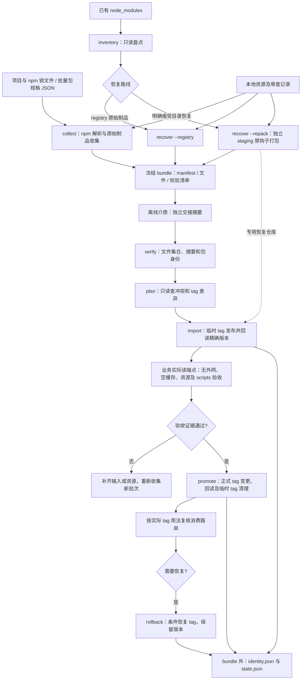

# Hermes：实现架构与运行指南

日期：2026-10-12 · 首版 CLI · Ponytail full

本项目包名为 `@nova-cbb/hermes`，命令为 `nova-hm`。用一个 Node.js 命令行程序完成收集、校验、导入和 tag 恢复。依赖解析、tarball 获取和发布协议交给 npm；清单和执行状态保存为 JSON。命令和参数由 cac 声明，通用校验交给 npm 生态库；不引入数据库、常驻服务或 Web 管理端。

外网生成冻结的 `bundle`，内网用临时 tag 导入精确版本，真实业务验收后才提升正式 tag。只有 `node_modules` 时，先盘点现存实例；优先回源取原始制品，显式 `--repack` 才从安装目录恢复打包。

本文描述当前 CLI。更完整的资源、平台、脚本与运维要求见 [技术方案和操作手册](operations.md)。本地检查不能代替目标私服及业务验收。

## 1. 流程与模块



| 模块                                | 职责                                                   |
| ----------------------------------- | ------------------------------------------------------ |
| `src/cli/index.ts`                  | 可执行入口、脱敏错误/处理提示与退出状态                |
| `src/cli/program.ts`                | cac 命令、选项、互斥关系和自动帮助                     |
| `src/cli/actions.ts`                | 参数到业务函数的映射、结果展示与进度生命周期           |
| `src/cli/output.ts`                 | 终端中文摘要、JSON 输出兼容及常见错误处理提示          |
| `src/lib/index.ts`                  | 公共能力导出入口，保留现有业务模块调用方式             |
| `src/lib/packages.ts`               | npm 包名、精确 SemVer、registry 规格及 dist-tag 校验   |
| `src/lib/npm.ts` / `security.ts`    | 受控 npm/子进程调用、端点边界与错误脱敏                |
| `src/lib/files.ts` / `artifacts.ts` | 原子文件写入、路径/SRI/SHA-256、归档与 bundle 校验     |
| `src/config.ts`                     | 已验证 npm 版本及输出上限                              |
| `src/core/collect.ts`               | 编排收集与恢复，保留原有公开入口及失败清理             |
| `src/core/collection/`              | 分离输入解析、原制品、重打包、资源复制与批次冻结       |
| `src/core/recovery.ts`              | 编排安装树盘点与独立 staging                           |
| `src/core/installed/`               | 分离 node_modules 路径边界、内容摘要和递归扫描         |
| `src/core/publish.ts`               | 编排精确版本导入、正式 tag 提升与条件恢复              |
| `src/core/publishing/`              | 分离目标预检、run 持久化、版本导入、tag 操作与验收计划 |
| `src/cli/progress.ts`               | stderr 文字统计、cli-progress 终端进度条及 ETA         |

完整文件职责和阅读顺序见 [文件指南](file-guide.md)。收集、恢复与发布入口只编排流程；安装树扫描、单版本导入、tag 计划/写入、制品检查分别由短函数负责。

模块依赖从顶层入口流向具体步骤，再到 `src/lib/`；内部契约共享 `core/types.ts`，发布适配器契约放在 `publishing/context.ts`。run 状态仍由调用流程按原顺序传递，不引入全局可变状态。对外导出保持兼容，目录拆分不改变 manifest/run 格式。

当前串行处理制品，状态在外部写入前后持久化。先满足可核对和可恢复，再根据真实批量耗时决定是否增加并发。

## 2. 工具链与支持范围

运行需要 **Node.js 22.12+ 或 24+（推荐 Node 24 LTS）、npm 11.19.0、系统 `tar`**。npm 版本为打包路径的硬校验；Node 24.21.0 是本地钩子验证所用版本。不要用旧 npm 的目录 `pack --ignore-scripts` 推断 prepare 已禁用。首版操作说明面向 POSIX 环境；Windows 原生路径、权限和 tar 行为需另外验证，可先在 WSL 使用。

```sh
# 外网准备 CLI 本身；ignore-scripts 不会删除依赖包的 scripts。
npm ci --ignore-scripts --no-audit --no-fund
npm run build
npm link --offline --ignore-scripts --no-audit --no-fund
node --version
npm --version
tar --version
nova-hm --help
```

源码使用 TypeScript；质量检查使用 Oxlint/Oxfmt，回归测试使用 Vitest，文档站使用 VitePress。开发命令见[开发指南](development.md)。

CLI 的直接依赖采用精确版本，传递依赖由 `package-lock.json` 固定。CLI 采用与 Vite 一致的 `cac`；校验库采用 npm 生态实现。

| 库                                                                            | 用途与选择依据                                                                        |
| ----------------------------------------------------------------------------- | ------------------------------------------------------------------------------------- |
| [cac](https://github.com/cacjs/cac)                                           | 与 Vite 相同的 CLI 解析库，提供命令、重复参数、自动帮助和版本；业务层保留互斥校验     |
| [cli-progress](https://github.com/npkgz/cli-progress)                         | TTY 刷新、终端宽度、进度条与 ETA；重定向仍输出普通文字                                |
| [semver](https://github.com/npm/node-semver)                                  | 精确版本和 tag 的范围歧义校验；额外要求版本为规范形式，拒绝 v 前缀/空白               |
| [npm-package-arg](https://github.com/npm/npm-package-arg)                     | 识别 registry 范围/tag/version 与 Git、file、URL、alias；业务仍拒绝非 registry 根输入 |
| [validate-npm-package-name](https://github.com/npm/validate-npm-package-name) | 采用 npm 的可发布包名规则                                                             |
| [ssri](https://github.com/npm/ssri)                                           | 流式 SRI 校验和最强算法选择；未知/非法项仍阻断，SHA-1 仅兼容旧上游 shasum             |

**离线运行工具的准备**：在外网执行上面的 `npm ci`，将构建后的 `dist/`、`package.json`、`package-lock.json` 和安装好的 `node_modules/` 作为独立工具交付物一起带入内网；同时提供目标平台可运行的 Node/npm/tar。内网在工具目录执行一次 `npm link --offline --ignore-scripts --no-audit --no-fund` 注册命令，再运行 `nova-hm --version`、`--help` 确认工具可启动。不要在无外网且没有完整私服依赖时执行 `npm ci`，该命令会先清空现有 node_modules。CLI 的依赖和运行时不包含在业务 bundle 内，需要独立记录工具版本与交接摘要。若改为从内网私服安装 CLI，先完成这些依赖的镜像并验证锁文件的读取路由。

### 默认参数与安装树查找

日常入口参见 [最短使用流程](index.md)。路径默认相对当前工作目录：输出/输入 bundle 为 `./bundle`，run 为 `./runs/default`，验收文件为 `./acceptance.json`，进度为 `auto`。既有 bundle 不覆盖，新的批次需换工作目录或显式指定路径；同一 run 的批次/端点约束继续生效。

collect 未传输入时先找当前目录 `packages.json`，其次找 npm-shrinkwrap/package-lock；只自动采用有 npm 锁的项目，缺输入时给出操作提示。收集/原制品恢复默认源为 npm 官方源。发布省略 registry 时读取 npm 的有效配置，配置仍为 `registry.npmjs.org` 时拒绝自动发布；写入目标不能凭工具猜测。显式配置的参数优先，repack/recovery/tag 覆盖仍须明确选择。

inventory/recover 未传 node_modules 时，从当前目录逐级向上查找最近的安装树；当前位置本身为 node_modules 时直接使用。不会向下枚举所有项目或搜索整块磁盘。显式入口和其 realpath 都必须为 node_modules 目录，实例的真实路径必须包含独立的 node_modules 路径段。来源树外的实体还需 allow-link-root，且登记目录必须在另一 node_modules 内；外部源码/workspace 或裸 store 目录不能借此加入发布。pnpm 在 node_modules 内的 `.pnpm` 实体与嵌套链接仍正常扫描。

| 输入或行为                                   | 当前支持                                                                                               | 明确边界                                                                    |
| -------------------------------------------- | ------------------------------------------------------------------------------------------------------ | --------------------------------------------------------------------------- |
| `collect --project`                          | `package.json` 加 npm v2/v3 锁文件；shrinkwrap 优先；临时副本 `npm ci --dry-run --ignore-scripts` 校验 | 必须有锁；不自动生成缺失项目锁，不复制业务源码或项目 `.npmrc`               |
| `collect --packages-file` / 重复 `--package` | JSON 字符串数组可与命令行根规格合并；各根独立生成锁，再按实际 name/version 合并                        | 与 project 互斥；不证明多个根一起安装时 peer 兼容，不收集全部历史版本       |
| 传递依赖                                     | 枚举锁文件全部 `packages`；保留多版本；记录 alias 实际身份                                             | Git、file/link、workspace、未知协议阻断；不自行求解 SemVer/peer             |
| `inventory`                                  | 普通 npm/Yarn 安装树、各层 node_modules 内的 pnpm `.pnpm` / Yarn `.store`、scope、嵌套包、受控链接     | PnP zip/loader 不支持；盘点不证明缺失依赖或原业务根完整                     |
| `recover --registry`                         | 按实例实际 name/version 获取上游 tarball                                                               | 不保留本地补丁、安装后修改或原安装副作用                                    |
| `recover --repack`                           | 内容副本禁钩子打包；保留 scripts，计算新 integrity                                                     | 不重放补丁或构建；拒绝声明 bundledDependencies 的目录恢复；使用专用恢复仓库 |
| 非 npm 资源                                  | `--resources` 指定本地文件/目录、使用说明、平台及审查证据                                              | 不自动下载 URL，不扫描脚本猜全资源，不部署资源服务                          |
| 发布与 tag                                   | 同版本实际字节比对、临时 tag 导入、验收后正式 tag、条件回滚                                            | 不同步 deprecated 到目标，不删除版本，不协调跨机器写入                      |

`--install-flag` 仅接收 `--legacy-peer-deps`、`--strict-peer-deps`、`--install-links=true`、`--install-links=false`，传参形如 `--install-flag=--legacy-peer-deps`，可重复。只有原业务确实使用这些参数才传入，不能为解决解析失败随意改树。其他项目配置应先在外网生成受控 npm 锁并验证；首版不承诺复现任意 `.npmrc`。

`targets` 默认记录收集机的 OS/CPU/libc/Node/ABI，属于当前批次声明，**不会自动生成完整平台矩阵**。需要 Linux、Windows、不同架构或 ABI 时，逐环境收集资源并实测，扩展交付范围另建批次。依赖的跨平台条目若已在锁文件中会收集；运行时能否使用仍由目标验收决定。

## 3. 冻结交付物与运行状态

```text
bundle/
  manifest.json
  checksums.sha256
  packages/000001.tgz
  metadata/000001.json
  inputs/project/package.json
  inputs/project/package-lock.json       # 或 npm-shrinkwrap.json
  inputs/root-1/...                      # 根包规格模式
  inputs/inventory.json                  # 安装树恢复模式
  resources/<id>/...

runs/batch-a/
  identity.json
  state.json
  .lock                                 # 命令执行期间存在
```

三种 `inputs` 路径按收集模式出现。业务源码、部署配置和业务验收日志由部署方另外交付，CLI 不自动打入 bundle。`--out` 必须不存在；失败目录留作现场，重新收集用新目录。

### 3.1 Manifest v1

| 字段                              | 当前含义                                                                             |
| --------------------------------- | ------------------------------------------------------------------------------------ |
| `schemaVersion` / `status`        | `1` / `complete` 才可导入                                                            |
| `batchId` / `capturedAt` / `mode` | 批次、时间、mirror 或 recovery                                                       |
| `toolchain` / `targets`           | 收集工具版本与本批平台声明                                                           |
| `roots` / `inputs`                | 根规格及冻结声明/锁/盘点报告路径                                                     |
| `packages`                        | 包 ID、name/version、制品类别、tarball 路径、SHA-256、实际 SRI、元数据路径、来源证据 |
| `tagPlan`                         | 每包源 tags、可用版本的 `set`、不在本批的 `excluded`                                 |
| `resources` / `resourceReview`    | 本地资源文件、平台、使用说明及人工审查证据                                           |
| `exceptions`                      | 锁文件内嵌依赖、未选择 optional peer 等已分类条目                                    |
| `files`                           | 交付相对路径到 SHA-256，排除 manifest/checksums 自身                                 |

原始制品为 `registry-original`，保留源 SRI 并核对 tarball 字节；目录恢复为 `installed-repack`，`sourceIntegrity` 为未知，另算实际 `artifactIntegrity`。包身份读取归档内 `package/package.json`，不从文件名猜测。同一 name/version 不允许不同内容并存。

`verify` 检查已登记文件集合、路径、哈希、SRI、tarball 包身份及资源文件登记。归档中的符号链接、硬链接和特殊文件直接拒绝，不在本地展开执行。它不执行包代码，也不自动证明入口、内嵌 shrinkwrap 外网 URL、publishConfig、许可证、原生 ABI 或业务功能可用；这些仍需审查和安装验收。源 SRI 缺失直接阻断原始制品收集。

`checksums.sha256` 覆盖已登记文件和 manifest，排除自身；`manifestDigest` 是 manifest 实际字节的 SHA-256。交接另外对归档计算摘要，经独立可信渠道核对。哈希证明字节一致，不单独证明来源真实。交付后不修改 manifest 或资源，修复后生成新批次。

### 3.2 Run

`identity.json` 首次导入写入，绑定 bundle 绝对路径、manifestDigest、冻结 manifest、写/读 registry、恢复模式、原始包级 tag 快照和随机临时 tag。`state.json` 用 identity 文件摘要绑定原件，记录版本验证、临时 tag 所有权、tag 变更意图、验收记录、次数和 phase。

首次预检失败后，若 run 中除本次锁之外没有任何文件，原命令可重新初始化；已有身份/状态或其他文件的不完整 run 仍拒绝重新初始化。盘点后进入 staging 时复核真实路径，目录被替换为链接时拒绝恢复。

续跑复用同一 `--run`，必须保持 bundle、读写端点和恢复模式一致。不能将原始快照替换成修改后的 tags。JSON 写临时文件并同步后原子落盘；运维仍需保留目录备份。同 run 有本地排他锁；跨 run、跨机器操作同仓库必须由部署方安排单写者或维护窗口。

## 4. 外网收集

以下使用本地工具通过 `npm link` 注册的 `nova-hm` 命令，可从业务目录或批次工作目录调用。示例路径和 registry 需要替换，凭证/CA 沿用受控 npm 配置；不要将 token 放在 URL、bundle 或命令记录中。机器读取 stdout 时使用 `nova-hm` 或 `npm --silent run cli --`，普通 npm run 会另外打印脚本头。

### 4.1 批量输入

```sh
nova-hm collect \
  --project /absolute/path/to/business \
  --out /absolute/path/to/bundle \
  --registry https://registry.npmjs.org/ \
  --resources /absolute/path/to/resources.json

# 独立根包模式，与 --project 互斥；范围/tag 会先由 npm 冻结为具体版本。
nova-hm collect \
  --package example-package@1.2.3 \
  --package @example/widget@2.0.0 \
  --out /absolute/path/to/another-bundle \
  --registry https://registry.npmjs.org/ \
  --resources /absolute/path/to/resources.json

nova-hm verify --bundle /absolute/path/to/bundle
```

大量根规格可保存为 `packages.json` 的非空 JSON 字符串数组；不展开包名/文件 glob，不接收行文本或包对象；npm 版本范围仍可使用标准范围语法：

```json
["example-package@1.2.3", "@example/widget@2.0.0", "another-package@^3.0.0"]
```

```sh
nova-hm collect \
  --packages-file /absolute/path/to/packages.json \
  --package extra-package@4.0.0 \
  --out /absolute/path/to/batch-bundle \
  --registry https://registry.npmjs.org/ \
  --resources /absolute/path/to/resources.json \
  --progress=plain > collect-result.json
```

文件输入与重复 `--package` 可合并，两者与 `--project` 互斥。每个根独立解析并保留锁，再合并相同制品；包的全部层级依赖由 npm 选定。当前批量执行串行，不能把根个数当作最终制品总数。

下载 URL 默认须与源 registry 同 host，额外 CDN 主机使用重复 `--allow-host cdn.example.com` 明确登记；该值为 `host`，非 URL，非通配符。源元数据的签名 URL 可用于当前下载，但查询参数不写入源元数据；输入锁文件内带凭证、查询参数或 fragment 的 resolved 会阻断，避免原锁复制泄露信息。网络出口、重定向及凭证访问范围仍由运行环境约束。

### 4.2 进度与统计

进度写 **stderr**，命令结果写 **stdout**：终端默认中文摘要，管道/重定向默认 JSON，`--json` 强制完整 JSON，方便将结果重定向保存。`--progress=auto` 为默认：终端显示进度条，非终端显示文字；`plain` 固定文字；`none` 关闭进度。收集/发布等有进度事件的阶段，终端在耗时操作期间定期刷新，普通文字按包/阶段更新。显示当前工作、完成计数和已完成制品字节；终端 ETA 由 cli-progress 根据当前阶段进度估算，只作参考。inventory 当前在盘点完成后报告实例数，verify 输出最终校验结果，不显示逐文件扫描进度。

```sh
# 自动检测终端；进度和结果都可分别保存。
nova-hm import \
  --bundle /absolute/path/to/bundle \
  --registry https://npm.intranet.example/hosted/ \
  --run /absolute/path/to/runs/batch-a \
  --progress=plain > import-result.json 2> import-progress.log
```

输出 `stats` 描述**本次命令执行**：

| 字段                           | 含义                                                                                                                                    |
| ------------------------------ | --------------------------------------------------------------------------------------------------------------------------------------- |
| `total`                        | 本次批次的制品总数；解析根包、tag 清理等阶段的进度计数另行显示                                                                          |
| `downloaded` / `downloadBytes` | 收集/回源恢复为源 tarball；plan/import/promote 为目标回读校验取得的 tarball。记录校验通过次数及实际文件字节，同一版本再次校验可再次计数 |
| `repacked` / `packedBytes`     | 收集/恢复命令中从安装树生成并校验的恢复制品个数及 tarball 字节；正常源收集为 0，发布命令不返回这两个字段                                |
| `uploaded` / `uploadBytes`     | 本次导入发布后回读通过的新 tarball 个数与实际文件字节                                                                                   |
| `reused`                       | 收集/恢复时重复身份复用已有制品的次数；预检查/导入/提升时确认目标已存在且实际内容一致的制品个数                                         |

按命令解释源下载与目标校验下载，不把两者当作一类业务数量。制品获取使用独立缓存，避免旧 tarball 掩盖远端内容变化；`downloaded` 仍只统计逻辑制品取得/校验次数，不代表 HTTP 实传总量。文件字节统计不包含元数据、资源复制、HTTP 编码/请求体膨胀或网络重试流量；也不是整个 registry 或历史 run 的累计容量。阶段进度和已完成制品字节可观察，但 npm 子进程不能提供真实逐字节上传进度，界面不会伪造网络百分比。计数不写入冻结 bundle，不改变批次摘要；inventory/verify 的盘点或文件校验结果也不等同上传统计。

### 4.3 本地资源

资源配置中的 `source` 相对配置文件目录解析；既可以是单文件，也可以是已审查缓存目录。禁止目录内符号链接，复制后所有文件加入校验清单。CLI 计算交付摘要；下载资源时的来源真实性和预期摘要核对由审查者负责。

```json
{
  "resources": [
    {
      "id": "browser-cache",
      "source": "./assets/browser-cache",
      "targets": [{ "os": "linux", "cpu": "x64" }],
      "instructions": "复制至验收机的固定缓存目录，并按该包官方方式配置缓存路径；核对可执行权限与实际启动路径。"
    }
  ],
  "review": {
    "status": "reviewed",
    "evidence": ["review/resource-audit.md：记录来源、预期摘要、scripts 与目标平台核对结果"]
  }
}
```

确认本批无需额外资源时也要提供显式审查记录：

```json
{
  "resources": [],
  "review": {
    "status": "reviewed",
    "evidence": [
      "review/no-extra-resources.md：说明已审查哪些包、脚本与实际功能，及无额外下载的依据"
    ]
  }
}
```

不提供资源配置可以收集/导入，但 `resourceReview` 保持 `pending`，不能正式提升 tags。证据字符串用于追踪记录；CLI 不读取证据内容或替操作者完成审查。资源实际部署及共享入口切换由部署方执行，`rollback` 不恢复资源入口。

## 5. 只有 node_modules

```sh
nova-hm inventory \
  --node-modules /absolute/path/to/node_modules \
  --out /absolute/path/to/inventory.json

nova-hm recover \
  --node-modules /absolute/path/to/node_modules \
  --out /absolute/path/to/original-bundle \
  --registry https://registry.npmjs.org/ \
  --resources /absolute/path/to/resources.json

# 无法找回原制品且已接受恢复限制时，显式选择重打包。
nova-hm recover \
  --node-modules /absolute/path/to/node_modules \
  --out /absolute/path/to/repacked-bundle \
  --repack \
  --resources /absolute/path/to/resources.json
```

`inventory` 不提供 `--out` 时在 stdout 输出结果：终端摘要，重定向或 `--json` 为完整 JSON。其他 node_modules 内的合法链接实体用重复 `--allow-link-root /absolute/other/node_modules` 登记；外部源码目录即使登记也会拒绝。断链、包内不安全链接、同名同版本不同内容等 issues 会阻断 recover。

盘点保留实例 realpath、locations、内容摘要、store/peer context，不修改源树、不执行 install/rebuild/prune/dedupe。`--repack` 实体复制到独立 staging，排除普通 `node_modules`，拒绝声明的 bundledDependencies；不会修改原 store 的硬链接文件。

打包固定 npm 11.19.0，并用 `--ignore-scripts` 禁钩子，**tarball 内 scripts 保留**。npm 的 `files`/ignore 规则仍会筛选文件，所以 pack 成功不能证明已安装的产物完整进入归档。消费端单独审查 prepare/install/postinstall 及隐式 node-gyp 行为。原生二进制限定原平台/ABI；更多说明见 [手册第 13 节](operations.md#13-仅有-node_modules恢复与发布)。

恢复包不推测历史 `latest`，重打包批次当前没有源 tag 计划。通过精确版本使用专用恢复仓库；`plan`/`import` 加 `--recovery` 才接受该类别，仓库隔离和业务读路由由部署方确认。该开关是显式接受恢复路径，不会自动创建或鉴别仓库性质。

## 6. 内网版本导入与 tag 提升

```sh
nova-hm verify --bundle /absolute/path/to/bundle

nova-hm plan \
  --bundle /absolute/path/to/bundle \
  --registry https://npm.intranet.example/hosted/ \
  --read-registry https://npm.intranet.example/group/

nova-hm import \
  --bundle /absolute/path/to/bundle \
  --registry https://npm.intranet.example/hosted/ \
  --read-registry https://npm.intranet.example/group/ \
  --run /absolute/path/to/runs/batch-a

# 完成真实业务验收并生成 acceptance.json 后：
nova-hm promote \
  --run /absolute/path/to/runs/batch-a \
  --acceptance /absolute/path/to/acceptance.json

# 需要恢复时：
nova-hm rollback --run /absolute/path/to/runs/batch-a
```

`--read-registry` 默认等于写端点；存在聚合读路由必须显式填写。`plan` 只读，不创建 run。它查询目标精确版本；已存在则下载并比对实际 SHA-256，不能只信元数据。目标返回的 tarball 当前要求与写 registry 同 origin（协议/主机/端口），不接受另一个 CDN 域名；部署前核对反向代理下载地址。相同内容复用，不同内容阻断，只有明确 E404 才视为缺失。目标权限若会将无权访问伪装成 404，应先用管理员/测试命名空间核对，CLI 无法区分伪装响应。

`import` 先保存身份与原始 tags，再用本 run 的随机临时 tag 发布已有 `.tgz`，全部回读一致后返回 `versions-ready`。该结果只表示版本已就绪。发布超时后先查目标，已成功则继续，不盲目重复上传。可用同一命令和 run 续跑；回滚完成的 run 关闭，新导入用新目录。

`promote` 重新校验 bundle、目标版本和验收记录，再逐项执行正式 tag。源 tag 目标不在本批则排除，不补最高版本为 latest。已有正式 tag 指向不同版本默认拒绝覆盖；审查 plan 和原始快照后，确需替换才加 `--overwrite-tags`。中途失败尝试条件恢复已执行 tags，并保留状态；不要以修改 state 消除错误。

`rollback` 不删除版本。当前 tag 仍等于本 run 写入值时才恢复旧值/移除新 tag，否则登记冲突。临时 tag 只清理本 run 拥有的值；清理失败留待续跑。tag API 的读取和写入不是原子 CAS，维护窗口/单写者条件不能省略。tag 恢复不会改变已安装项目的锁、缓存、业务部署或资源入口。

## 7. 验收契约

`acceptance.json` 由实际验收者或流水线生成，不能将导入成功直接填成通过。以下是字段模板，`manifestDigest` 和 `targets` 必须从本 run 的 `identity.json` 原样取得，端点与该 run 一致；targets 对象和数组顺序也要一致。

```json
{
  "status": "passed",
  "manifestDigest": "identity.json 中的实际 manifestDigest",
  "writeRegistry": "https://npm.intranet.example/hosted/",
  "readRegistry": "https://npm.intranet.example/group/",
  "targets": [
    {
      "os": "linux",
      "cpu": "x64",
      "node": "v24.21.0",
      "nodeAbi": "实际值",
      "libc": "实际值"
    }
  ],
  "resourceReview": "reviewed",
  "evidence": [
    "acceptance/install-build-run.log：测试人员/任务、时间、客户端版本及实际安装/构建/运行结果",
    "acceptance/network-and-resources.md：空缓存、外网阻断、被拦截请求、资源路径与摘要、scripts 许可记录"
  ]
}
```

CLI 检查状态、摘要、读写 registry、平台声明、resourceReview 和非空 evidence；同时要求冻结 manifest 内的资源审查已通过。证据文件由交付记录保存，CLI 不验证证据内容真实性，也不自动运行业务 scripts。

验收先在干净环境禁安装脚本确认依赖/制品，再在另一干净环境按已审查脚本许可安装并运行实际功能。只允许内网私服及交付资源，使用空包缓存和业务实际 scope/聚合读路由；不能靠用户旧缓存或代理回源掩盖缺项。锁中的绝对外网 URL、内嵌 shrinkwrap、平台跳过和 optional 静默降级都要核对。需要改消费锁时保留源锁，单独生成并审查内网副本，不能改 integrity 绕过验证。

验收发生在正式 tag 提升前，先使用精确版本/冻结锁。提升后再核对真实 tag 安装场景；原 `npm ci` 成功不能证明 tag 选择正确。后续消费验收失败需要人工调用 rollback，并处理业务与资源部署恢复。

## 8. 运维与未覆盖项

- 所有路径使用明确绝对路径；run 置于 bundle 外。先预估 tarball、资源、staging、缓存、发布请求编码和私服空间。
- 认证和 CA 使用现有受控 npm 配置。registry 只接受 HTTPS，回环本地测试允许 HTTP；确认 hosted 写端点、scope 路由和实际 tarball 地址。
- 收集失败目录不可当作完整 bundle 导入。普通失败可保留现场后新建输出；已冻结批次修复另建批次。
- `.lock` 残留先核对记录中的进程、机器和执行状态，确认无写者后才人工移除；不自动抢占。
- 状态和原始 tag 快照备份并限制权限。禁止同时从另一 run/机器修改同仓库 tags。
- 重打包保留包名版本只在隔离恢复仓库成立；正常仓库用 tag 不能隔离同名同版本的不同字节。

首版没有自动资源发现/下载/部署、Yarn/pnpm 原生锁解析、PnP 导出、Git/workspace 迁移、补丁重放、bundled 目录恢复、共享并发协调、弃用信息写回、差量基线或 Web 界面。需要这些能力的业务先补明确方案，不把未覆盖项当作成功。

本地验证入口是 `npm test`；实际通过项目以本次执行结果为准。目标私服产品/版本、最大包上传、无外网业务安装以及各平台资源仍须部署方验收。包级恢复测试不能替代缺失业务根/源码的完整业务迁移证明。

## 9. 本地验证结果（2026-10-12）

Node 24.21.0 / npm 11.19.0 下，`npm test` 的 **50 项 Vitest 测试全部通过**。测试仓库仅监听本机临时端口，不向真实私服发布。

| 范围             | 测试与结果                                                                                                                                         |
| ---------------- | -------------------------------------------------------------------------------------------------------------------------------------------------- |
| 输入和制品       | 8 项：CLI 默认帮助、重复单值末次覆盖及异步错误，锁文件身份、npm 包名/规范版本/tag、非 registry 输入、SRI、路径、额外文件、字节变更及归档链接阻断   |
| 安装树           | 8 项：嵌套/scope、pnpm 与 Yarn store 布局夹具、自动发现、node_modules 实体边界/受控链接、内容冲突、独立 staging 及盘点后路径替换阻断               |
| 发布和恢复       | 23 项：版本冲突、重复导入、空 run 重试/非空不完整 run 保护、丢失响应、原始快照、验收绑定、tag 覆盖许可及条件回滚                                   |
| CLI 进度与默认值 | 4 项：终端刷新、文字/关闭模式、批量 JSON 输入校验/合并、默认输入与发布配置、公网默认发布阻断及统计格式                                             |
| CLI 结果展示     | 4 项：终端摘要、管道/--json 完整记录、未完成状态/问题数量、错误提示及脱敏                                                                          |
| 真实 npm 集成    | 3 项：批量根与三级依赖收集、原 tarball 字节保留、省略 bundle/run/registry 的上传、消费安装/tag 提升/回滚；目录禁钩子打包；嵌套 pnpm 夹具恢复及统计 |

集成测试同时确认 prepare、pack/publish 及安装钩子没有执行，tarball 内 scripts 保留。临时 tag 使用无 UUID 标点的随机后缀，避免 npm 将 UUID 形式的文本在 JSON 输出中脱敏后导致查询和清理不一致。制品操作禁用 npm 的后台更新查询。

这些结果证明首版 CLI 的本地行为。真实私服兼容性、实际 Yarn/pnpm 客户端安装、完整业务 scripts 许可、目标平台与额外资源仍按第 7 节验收。
