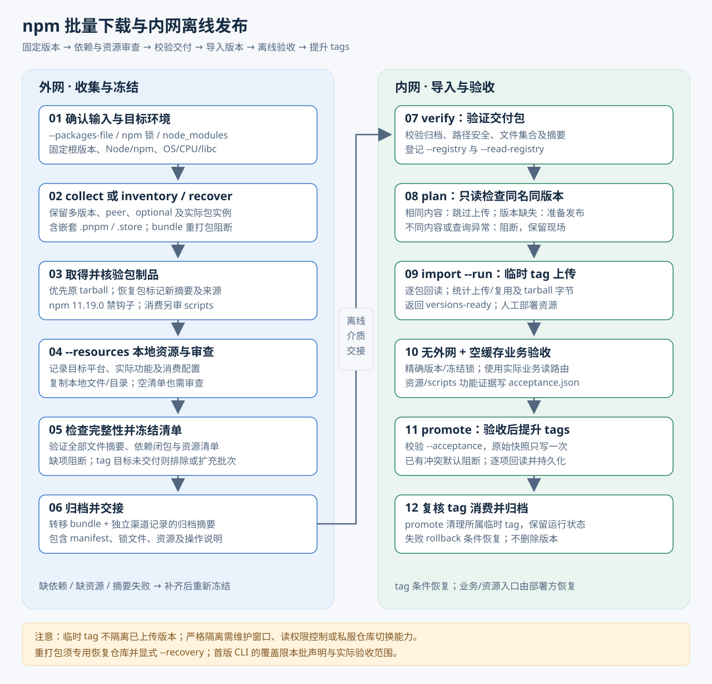

# Hermes：npm 批量下载与离线发布

**`@nova-cbb/hermes`**（CLI：`nova-hm`）把 npm 包及传递依赖收集成 `bundle/`，带入内网后批量上传私服。已有 `node_modules` 时，也能按安装树恢复包。

## 安装一次

工具需要 **Node 22.12+ 或 24+（推荐 Node 24 LTS）、npm 11.19.0、系统 tar**。工具发布到 npm 后，在运行工具的机器上全局安装：

```sh
npm install -g @nova-cbb/hermes
nova-hm --version
nova-hm --help
```

安装会自动注册 `nova-hm` 命令。之后切换到**业务目录或本批次的独立工作目录**；所有默认文件路径都相对于当前工作目录。需要固定工具版本时，在包名后加 `@版本号`，例如 `@nova-cbb/hermes@0.1.0`。

按环境要求可追加 npm 选项：`--ignore-scripts` 禁用包及依赖的安装脚本，`--no-audit` 关闭自动漏洞审计请求，`--no-fund` 隐藏赞助提示。这些都是可选参数；禁用安装脚本可能影响依赖的编译或文件下载。

> 不要在工具源码目录执行无参数 `collect` / `recover`，否则会读取工具自己的锁文件或 `node_modules`。

## 外网：选择一种收集方式

**有业务 npm 锁文件**：在业务目录执行，自动读取 `npm-shrinkwrap.json` 或 `package-lock.json`（v2/v3）：

```sh
cd /path/to/business
nova-hm collect
```

**按包列表下载**：在当前目录创建 `packages.json`，再执行同一条 `collect`。列表优先于当前项目锁文件：

```json
["commander@15.0.0", "semver@7.8.5"]
```

**只有 node_modules**：在业务目录改用 `recover`，自动向上寻找最近的 `node_modules`，扫描嵌套 npm/Yarn/pnpm 实例，再从源 registry 获取原始 tarball：

```sh
nova-hm recover
```

三种方式默认生成 `./bundle`，不会覆盖已有目录。新批次换工作目录，或指定 `--out ./bundle-batch-b`。

当前目录已有 `resources.json` 时，收集和恢复自动读取其中的资源与审查记录；也可用 `--resources` 指定其他文件。文件不存在时仍可收集，但资源审查保持 `pending`，正式 tag 提升前须补齐真实审查并重新收集新批次。

恢复入口和包实体的真实路径都必须在 `node_modules` 内；指向外部源码/workspace 的链接会阻断。`--allow-link-root` 也不能放宽这一约束。输出目录不能位于源安装树或获准链接的实体内；在 `node_modules` 内运行时，请切回业务目录或将 `--out` 指向树外。无法回源时，可按[恢复手册](operations.md#13-仅有-node_modules恢复与发布)显式重打包，并使用专用恢复仓库。

## 内网：批量上传

先将 Hermes 及其全部运行依赖导入内网私服，并准备相同工具链。在内网从可读私服安装与外网相同版本的工具，以下以 `0.1.0` 为例：

```sh
npm install -g @nova-cbb/hermes@0.1.0 \
  --registry=https://npm.intranet.example/group/
nova-hm --version
```

工具和它的依赖需单独准备，业务 `bundle/` 不包含这些依赖；只带入 Hermes 自身的 `.tgz` 不能保证断网安装。详细交付方式见[开发与发布指南](development.md#内网安装与交付)。

带入生成的 `bundle/`，在 **bundle 的父目录**按私服要求配置发布凭证，再设置可写的托管仓库地址。安装工具使用的聚合读端点与发布包使用的托管写端点可能不同：

```sh
npm config set registry https://npm.intranet.example/hosted/ --location=project
nova-hm import
```

`import` 自动校验制品、预检冲突并上传。上传失败后执行原命令续跑，保持 bundle、私服端点和 run 不变；日常不必另跑 `verify`、`plan` 或测试命令。

**上传完成表示精确版本就绪。** 正式 `latest` 等 tag 在实际业务验收后通过 `promote` 提升；浏览器、原生二进制等额外资源及消费端 scripts 仍须审查。见[验收与 tag 操作](architecture.md#6-内网版本导入与-tag-提升)。

## 默认值与结果

| 配置                                                                  | 不传时                                                      |
| --------------------------------------------------------------------- | ----------------------------------------------------------- |
| `--out` / `--bundle`                                                  | `./bundle`                                                  |
| `--run`                                                               | `./runs/default`；同批次续跑复用，新批次换目录或 `--run`    |
| `--node-modules`                                                      | 从当前目录向上查找最近的 `node_modules`                     |
| 收集/恢复 `--registry`                                                | npm 官方源；私有源需显式指定                                |
| 发布 `--registry`                                                     | 当前 npm 配置；隐式默认公网源会被阻断                       |
| `--read-registry`                                                     | 同写端点；业务使用聚合读端点时另行指定                      |
| `--resources`                                                         | 自动读取当前目录已有的 `resources.json`；不存在则审查待完成 |
| `--acceptance`                                                        | `./acceptance.json`，须填写真实验收证据                     |
| `--project` / `--packages-file`                                       | 优先当前目录 `packages.json`，其次当前项目 npm 锁文件       |
| `--package` / `--allow-host` / `--allow-link-root` / `--install-flag` | 空列表；按需重复传入                                        |
| `--repack` / `--recovery` / `--overwrite-tags`                        | `false`；须显式开启                                         |
| `--progress` / `--json`                                               | `auto` / `false`；终端摘要，重定向 JSON                     |
| `inventory --out`                                                     | 不写文件，结果输出到 stdout                                 |

默认值减少路径配置，资源审查和验收证据仍由实际操作者提供。显式 `--resources` 优先，其路径或内容错误会直接失败；安全开关不会自动开启。

终端默认显示中文结果摘要和进度统计。重定向或管道自动输出完整 JSON；`--json` 可显式选择 JSON。进度写 stderr，可用 `--progress none` 关闭：

```sh
nova-hm inventory --json
nova-hm import > import-result.json
nova-hm recover --help
```

错误会给出原因及适用的处理提示。退出码 `0` 表示完成，`1` 表示失败，`2` 表示有盘点问题或清理/回滚未完成；遇到 `2` 请查看结果中待处理项。

## 按需查阅

- [实现架构与完整参数](architecture.md)：命令示例、资源/验收 JSON、工具链与支持范围。
- [技术方案与操作手册](operations.md)：依赖闭包、平台资源、scripts 钩子、验收、恢复与排障。
- [总流程图](offline-npm-flow.svg)：收集 → 交接 → 导入 → 验收 → tag 提升。
- [文件职责与阅读指南](file-guide.md)：每个源码、测试、配置和文档文件的作用。

## 本地开发

```sh
npm run dev -- --help
npm run check
npm run docs:dev
```

使用 TypeScript、cac、Oxlint/Oxfmt、Vitest 和 VitePress。完整开发命令与交付方式见[开发指南](development.md)。


